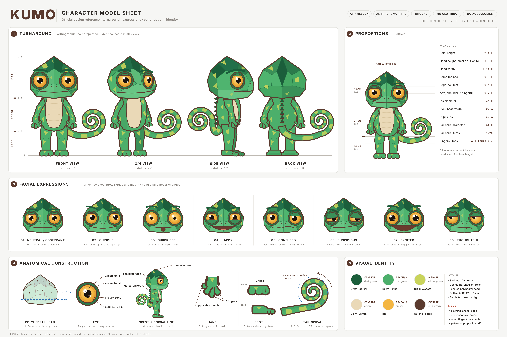
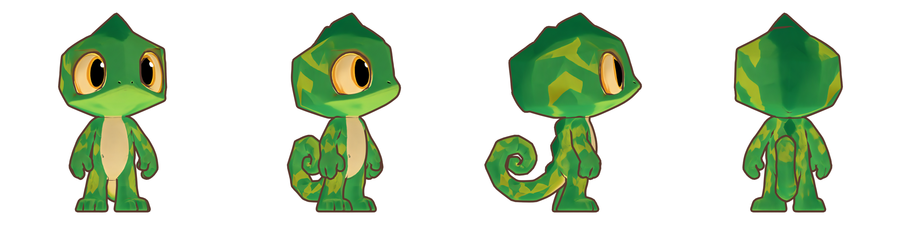

# Kumo-Character

## Character Model Sheet

A folha técnica oficial do Kumo, montada com a arte da própria referência, está em [`character-model-sheet/`](character-model-sheet/). As imagens de referência estão em [`referencia de modelo/`](referencia%20de%20modelo/).

## Modelo 3D oficial

O modelo 3D oficial do Kumo é o gerado no Hyper3D/Rodin, em [`kumo-3d-rodin/`](kumo-3d-rodin/): GLB para jogos e web, e cena do Blender com contorno estilo desenho.

O modelo procedural anterior está arquivado em [`kumo-3d-toon/`](kumo-3d-toon/ARQUIVADO.md).
