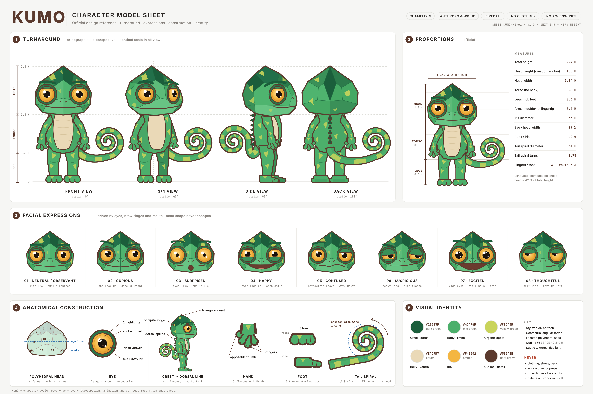

# Kumo — Character Model Sheet

Folha de referência técnica oficial do **Kumo**, camaleão antropomórfico bípede.
Construída a partir das imagens de referência em [`../referencia de modelo/`](../referencia%20de%20modelo/).



## Arquivos

| Arquivo | Conteúdo |
|---|---|
| `kumo-model-sheet.png` | Folha completa, 4800 × 3200 px (render 2×) |
| `kumo-model-sheet.svg` | Folha completa em vetor (2400 × 1600) |
| `views/kumo-{front,three-quarter,side,back}.svg/.png` | Cada vista do turnaround, isolada e com fundo transparente |
| `expressions/kumo-<expressão>.svg/.png` | As 8 expressões faciais, isoladas |
| `src/kumo.mjs` | Construção vetorial do personagem (geometria, paleta, expressões) |
| `src/build.mjs` | Monta a folha |
| `src/export-views.mjs` | Exporta vistas e expressões isoladas |
| `src/render.cjs` | Converte SVG → PNG (Playwright/Chromium) |

## Seções da folha

1. **Turnaround**: frente (0°), 3/4 (45°), perfil (90°) e costas (180°), ortográficas e na mesma escala, sobre uma grade em unidades de cabeça.
2. **Proporções**: cadeia de cotas e tabela de medidas oficiais.
3. **Expressões faciais**: neutro/observador, curioso, surpreso, feliz, confuso, desconfiado, empolgado e pensativo. Mudam só olhos, pálpebras, cristas das sobrancelhas e boca; a forma da cabeça nunca muda.
4. **Construção anatômica**: cabeça poliédrica com 14 faces numeradas e linhas-guia, olho, crista → linha dorsal, mão (3 dedos + polegar opositor), pé (3 dedos para a frente) e espiral da cauda.
5. **Identidade visual**: paleta, regras de estilo e restrições.

## Proporções oficiais (1 H = altura da cabeça)

| Medida | Valor |
|---|---|
| Altura total | 2,4 H |
| Cabeça (ponta da crista → queixo) | 1,0 H |
| Largura da cabeça | 1,14 H |
| Tronco (sem pescoço) | 0,8 H |
| Pernas com pés | 0,6 H |
| Braço, ombro → ponta dos dedos | 0,7 H |
| Diâmetro da íris | 0,33 H (29 % da largura da cabeça) |
| Pupila / íris | 42 % |
| Espiral da cauda | Ø 0,64 H · 1,75 voltas · anti-horária para dentro |
| Dedos / artelhos | 3 + polegar / 3 |

> As referências trazem a anotação "3,5 cabeças", mas o desenho dos próprios personagens mede cerca de 2,4 alturas de cabeça (a cabeça ocupa ~42 % da altura). A folha segue o desenho, para manter a silhueta fiel.

## Paleta

| Cor | Hex | Uso |
|---|---|---|
| Verde escuro | `#1B5E3B` | Topo da cabeça, crista e espinhos dorsais |
| Verde médio | `#4CAF6B` | Corpo, tronco e membros |
| Verde-amarelado | `#C9D45B` | Manchas orgânicas |
| Bege claro | `#EAD9B7` | Barriga / região ventral |
| Âmbar | `#F4B642` | Íris |
| Marrom escuro | `#5B3A2E` | Contorno e linhas de detalhe (2,2 % de H) |

As facetas usam tons intermediários entre o verde escuro e o médio, apenas para a iluminação.

## Restrições

Sem roupas, sapatos, mochilas, acessórios ou objetos. Não alterar o número de dedos (3 + polegar) nem de artelhos (3). Cores e proporções idênticas em todas as vistas. Sem perspectiva exagerada nas vistas técnicas. A espiral da cauda é o mesmo desenho, com o mesmo sentido de giro, em todas as vistas.

## Regenerar

```bash
cd character-model-sheet/src
node build.mjs ..                                   # kumo-model-sheet.svg
node render.cjs "$(realpath ../kumo-model-sheet.svg)" ../kumo-model-sheet.png 2
node export-views.mjs                               # views/ e expressions/ (SVG)
```

Requer Node 18+ e Playwright com Chromium para o PNG. As fontes usadas são Inter e JetBrains Mono; sem elas o SVG usa fontes alternativas.
