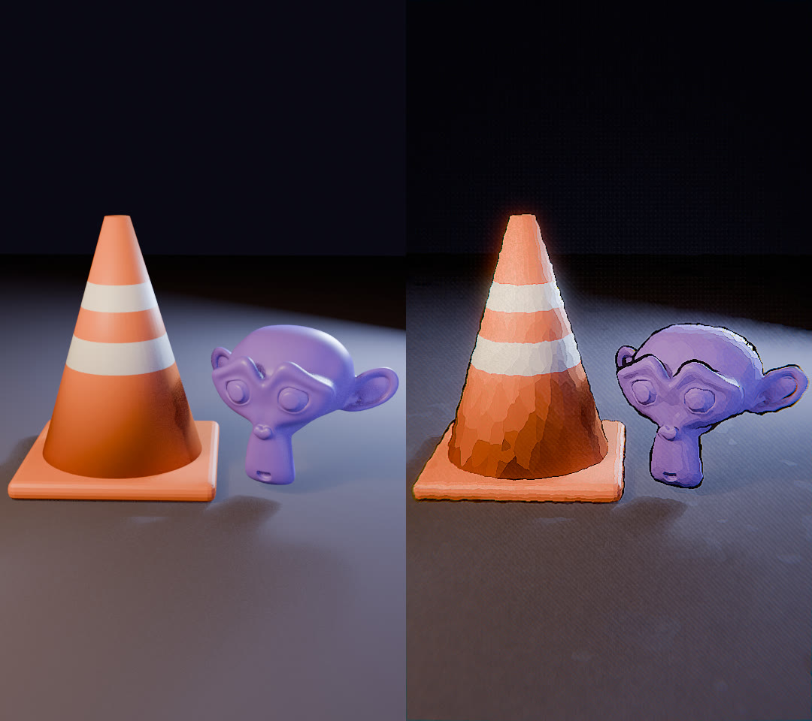

# Finalização "2.5D pintada" (referência: @alexandr.iwaac)

Estilo estudado em 37 vídeos do perfil [@alexandr.iwaac](https://www.tiktok.com/@alexandr.iwaac)
(artista de Blender, 263 posts; cerca de metade são obras dele, o resto são
republicações creditadas de outros artistas). Este documento só cobre a **finalização**:
o que transforma um render 3D comum em algo que parece pintado à mão.

Implementação pronta: [`blender/finish/iwaac_finish.py`](../blender/finish/iwaac_finish.py).



## Identidade do estilo

- **Tudo em tempo real (EEVEE).** Ele carimba "RealTime" em todo vídeo. Nada de Cycles.
- **3D que parece pintura digital**, entre anime e ilustração de livro: pinceladas
  visíveis na sombra, contorno escuro irregular, papel por cima.
- **Cor:** saturada, com contraste quente e frio. Luz principal quente (laranja/âmbar),
  recorte (rim) frio forte (azul/ciano), sombras puxadas para roxo e vinho. Fundos
  roxo escuro, azul petróleo ou pôr do sol laranja.
- **Brilho:** objetos emissivos (janelas, chamas, olhos, neon) sempre com bloom.
- **Acentos 2D em Grease Pencil:** riscos de velocidade, "!?", faíscas, contornos
  desenhados à mão por cima do 3D, nos quadros de ação.
- **Movimento:** câmera girando devagar em volta do objeto (turntable), tremor
  ("boil") de linha estilo desenho animado.

## As três camadas da finalização

### 1. Material: a "normal pincelada"

Lida no vídeo do cone (`Shader → Strokes → Voronoi`):

```
Geometry.Normal ─┐
                 ├─ Mix (Linear Light, fac ≈ 0.15) ─ Voronoi F1 (scale ≈ 6, rand 1)
Noise (scale 2) ─┘                                   └─ Position → Normalize → Principled.Normal
```

O Voronoi quantiza a normal em manchas: a sombra quebra em "pinceladas" chapadas
em vez de um degradê liso. O ruído entorta as manchas para não ficarem geométricas.
Ele junta a isso uma textura pintada à mão (Image Texture na cor base, roughness alto).

### 1b. Material: sombra tingida em degraus (`paint_shading`)

Nas peças dele a sombra nunca é só "mais escuro": ela vira roxo/vinho e muda em
poucos degraus, como em anime ("light → Color Ramp" no vídeo da moto).

```
Principled → Shader to RGB → luminância → ColorRamp (degrau 0.22 → 0.55)
   claro  = cor iluminada
   sombra = mistura 85% da cor base × roxo (0.36, 0.22, 0.72)
+ Layer Weight (Facing) → borda quente laranja somada
+ Voronoi.Color → ±12% de valor por "pincelada" na cor base
→ Emission
```

Os degraus dependem da exposição da cena. Se tudo ficar em sombra, abaixe `steps`;
se nada ficar, suba. Ajuste por cena com
`apply(shading_kw={"steps": (0.15, 0.4), "shadow_tint": (...)})`.

### 2. Geometria: contorno de Geometry Nodes

"geonode outline": casca invertida (Set Position pela normal → Flip Faces → material
escuro com backface culling). A espessura varia com um ruído, então a linha engrossa
e afina como traço de pincel. A cor é quase preta puxada para o vinho, nunca preto puro.

Cuidado: a casca precisa ser **transparente para raios de sombra**, senão ela escurece
o chão inteiro.

### 3. Compositor: a pilha de finalização

Lida nos vídeos "i really love blender compositing", "shader aov guide" e "Bike Shader".
Ordem e valores dele:

| # | Nó | Valores lidos | Para quê |
|---|---|---|---|
| 1 | AOV `noise` → **Displace** | X/Y −12 | borda tremida, linha "viva" |
| 2 | **Glare** Bloom, Medium | strength 0.367, saturation 1, size 0.1 | brilho dos emissivos |
| 3 | **Filter** Diamond Sharpen | 0.513 | prepara o Kuwahara |
| 4 | **Kuwahara** Anisotropic | size 4 (13 em close), uniformity 4, sharpness 1, eccentricity 1 | vira pintura |
| 5 | **Filter** Diamond Sharpen | 0.573 | devolve o traço |
| 6 | Imagem de **papel** + Transform (scale 0.15, Repeat) + Invert 0.383 → **Overlay** | mix ≈ 0.38 | textura de papel |
| 7 | Imagem "**Dots**" → **Screen** | baixo | meio-tom fino |
| 8 | **Sensor Noise** | luminance 0.151, chroma 0.05 | grão |
| 9 | **Chromatic Aberration** | 0.03 | lente |
| 10 | **Vignette** | factor 0.58, feather 0.42 | foca o centro |
| 11 | **Lens Distortion** Radial | dispersion 0.003 | franja de cor nas bordas |

Sensor Noise, Chromatic Aberration e Vignette são node groups da biblioteca
Essentials do Blender 5.x ("Camera & Lens Effects"). O script recria os três
com nós nativos, então funciona sem interface e sem assets externos.

## Como usar

```bash
# aplica tudo numa cena existente e renderiza um quadro
blender minha_cena.blend -b --python blender/finish/iwaac_finish.py -- --render //final.png

# mesma coisa, adicionando o rig de luz quente/fria
blender minha_cena.blend -b --python blender/finish/iwaac_finish.py -- --lights --save //final.blend

# teste completo (gera antes.png / depois.png)
blender -b --factory-startup --python blender/finish/test_scene.py -- /pasta/saida

# teste de animação: turntable de 48 quadros com tremor de borda
blender -b --factory-startup --python blender/finish/test_anim.py -- /pasta/saida
```

Dentro do Blender: `import iwaac_finish as f; f.apply(bpy.context.scene, kuwahara=8, paper=0.4)`.

### Botões principais (`compositor(...)`)

| Parâmetro | Padrão | Mais alto = |
|---|---|---|
| `kuwahara` | 4 | mais "pintado", menos detalhe (use 8–13 em close) |
| `bloom` | 0.37 | mais brilho |
| `displace_px` | 3 | borda mais tremida |
| `boil` | `True` | tremor muda a cada 2 quadros (desligue em still) |
| `paper` | 0.30 | papel mais forte |
| `dots` | 0.02 | meio-tom mais visível |
| `grain` | 0.12 | mais grão |
| `chroma` | 0.03 | mais aberração |
| `vignette` | 0.40 | bordas mais escuras |

No material: `painterly_material(mat, voronoi_scale=6, warp=0.15, strength=1)`.
Escala menor = manchas maiores. `strength` < 1 suaviza para personagens (rosto).

## O que ainda é manual

- **Grease Pencil por cima** (riscos, "!?", faíscas): desenhar por cena.
- **Textura pintada à mão** na cor base: o script só cuida da sombra e do traço.
- **Luz de cena**: `light_rig()` é ponto de partida; cada plano pede ajuste.
