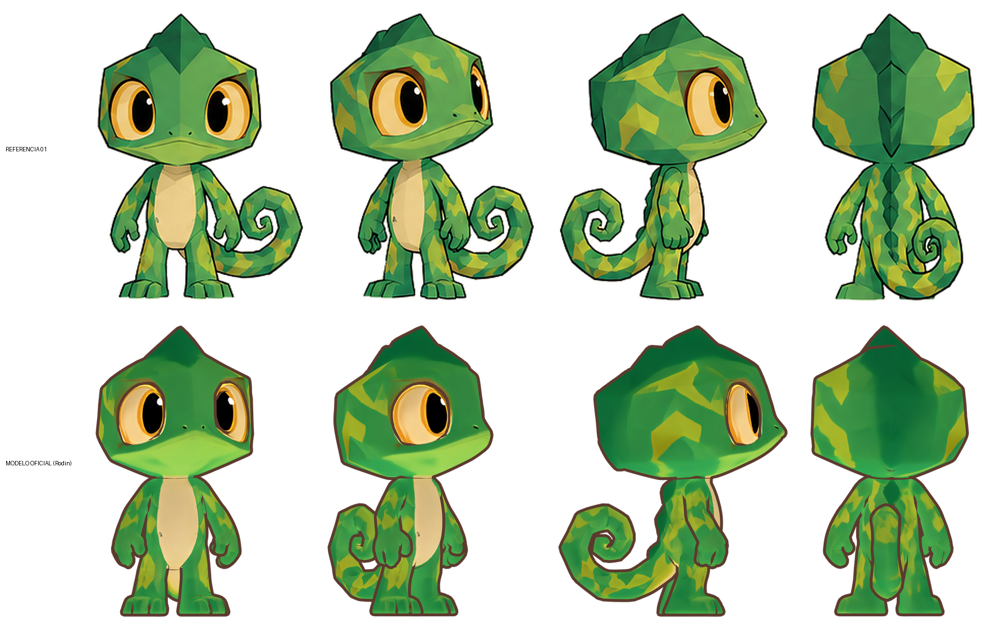
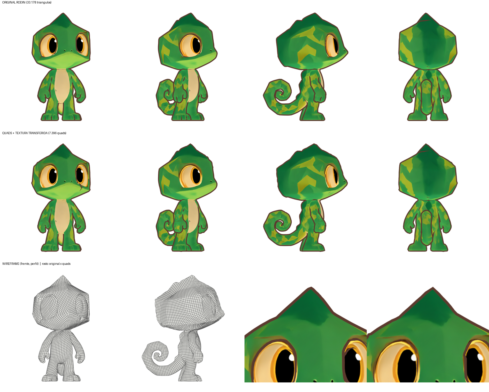
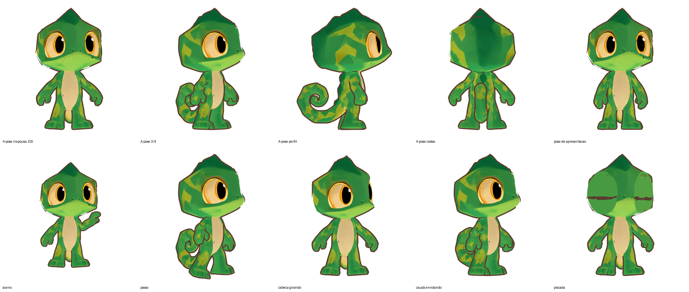

# Kumo — modelo 3D oficial (Rodin Gen-2.5)

**Decisão do dono (2026-11-10):** o modelo gerado no Hyper3D/Rodin passa a ser o **modelo oficial do Kumo**. O trabalho com o modelo procedural (`kumo-3d-toon/`) foi **encerrado e arquivado**, sem nada apagado.

## Arquivos

| Arquivo | Conteúdo |
|---|---|
| `base_basic_pbr.glb` | Modelo original do Rodin com textura PBR (difusa, metal/rugosidade, normal). Use em motores de jogo e na web. |
| `base_basic_shaded.glb`, `texture_emissive.png` | Variantes entregues pelo Rodin |
| `kumo_rodin.blend` | Cena do Blender pronta: modelo na escala do Kumo (pés em z = 0, altura total 1,96 = 1,96 cabeças), material toon de cor chapada, contorno por casca invertida e câmeras ortográficas (frente, 3/4 a 40°, perfil, costas, rosto) |
| `src/kumo_rodin_scene.py` | Gera o `.blend` e as renders a partir do GLB: `python src/kumo_rodin_scene.py --render --res 1400` (precisa de `bpy`) |
| `renders/` | Turnaround, vistas, rosto e comparação com a referência |

## Origem

- Geração `fc410dfd-caab-423a-8928-47542680b15e` na conta do dono, feita com a skill `.claude/skills/hyper3d-rodin`.
- Entradas: 5 recortes das referências oficiais (frente, 3/4, perfil, costas e rosto). Gen-2.5-Medium, 0,5 crédito.
- Cópia de referência intocada: `referencia de modelo/externas/rodin-fc410dfd/`.

## Ajustes feitos sobre o GLB (só na cena `.blend`; o GLB original fica igual)

- **Escala e posição:** padronizadas no sistema de medidas do projeto (fator 1,0356).
- **Costuras de textura soldadas por posição:** os UVs ficam nos cantos das faces, então a textura não muda. Eram 2.546 arestas não-manifold e agora são **0**.
- **Normais recalculadas para fora**, necessárias para o contorno funcionar.
- **Contorno por casca invertida:** modificador Solidify com normais invertidas, cor `#5B3A2E`. A espessura é ajustável pela propriedade `outline_thickness` do objeto (padrão 0,02).

## Malha

16.591 vértices (após a solda) e 33.178 faces, todas triângulos, numa malha única com olhos, corpo e cauda. Fechada e sem arestas defeituosas depois da solda.

## Silhueta contra a referência (IoU corpo inteiro / só cabeça)

| Frente | 3/4 | Perfil | Costas |
|---|---|---|---|
| 0,748 / 0,909 | 0,691 / 0,917 | 0,860 / 0,937 | 0,877 / 0,936 |

## Limitações conhecidas

- **Sem esqueleto e sem expressões.** Para animar, os caminhos são: o rig automático do Rodin (`hyper3d rigging`, gasta créditos, pose de corpo inteiro) ou um rig próprio no Blender. A malha triangulada deforma pior que quads nos olhos e na boca.
- **A cauda fica atrás do corpo** nas vistas de frente e de costas. Na referência ela aparece ao lado.
- **Facetas um pouco suavizadas** pela textura em relação à referência.

## Pipeline "estilo Rodin" no Blender: etapas 2–3 (2026-11-10)

`src/quad_retopo_bake.py` reproduz no Blender, sem créditos, o acabamento que o Rodin faz depois da IA:

1. carrega o GLB oficial, coloca na escala do Kumo e solda as costuras;
2. **remalha em quads** (QuadriFlow, com simetria em X), o equivalente ao modo "Quad" do Rodin;
3. cria UVs novos e **transfere a textura do Rodin** por bake (Cycles, "Selected to Active");
4. monta o material toon de cor chapada e o contorno por casca invertida, mais uma variante PBR para exportação.

| | Original Rodin | Quads (`kumo_quad.blend`) |
|---|---|---|
| Faces | 33.178 triângulos | **7.396 quads (100%)** |
| Vértices | 16.591 (soldados) | 7.398 |
| Silhueta igual ao original (IoU frente / 3/4 / perfil / costas) | — | 0,993 / 0,993 / 0,990 / 0,993 |

Arquivos: `kumo_quad.blend`, `export/kumo_quad.glb` (PBR, sem contorno), `textures/kumo_quad_diffuse.png` (2048²) e `renders/quad-*.png`.

**Limitações observadas:**
- um pequeno risco escuro aparece perto de um dos olhos, um artefato do bake na borda do olho;
- as arestas vivas da crista ficam levemente mais suaves;
- a malha de quads é uniforme, ainda **sem** anéis concentrados nos olhos e na boca. Esses anéis vêm na etapa de rig e expressões.

Regenerar: `python src/quad_retopo_bake.py --faces 8000 --tex 2048 --res 1200` (de dentro de `kumo-3d-rodin/`).

## Etapa 5: esqueleto, A-pose e piscada (2026-11-10)

`src/kumo_rig.py` transforma o `kumo_quad.blend` em **`kumo_rigged.blend`**, pronto para animar. Exporta também `export/kumo_rigged.glb` e `export/kumo_rigged.fbx`, com esqueleto, pesos e shape keys, sem o contorno.

- **Esqueleto `Kumo_Rig`, 30 ossos:** root, hips, spine, chest, neck, head; shoulder, upper_arm, forearm e hand dos dois lados; thigh, shin e foot dos dois lados; tail_01 a tail_10. As articulações foram medidas na própria malha. A cauda foi traçada pela distância ao longo da malha desde a base.
- **Pesos automáticos (bone heat):** 0 vértices sem peso.
- **Pose de repouso, decisão D3:** braços de -66.0° para **-45.0°**, ou seja, 45° abaixo da horizontal, e pernas levemente afastadas. A pose da referência, de braços baixos, fica guardada como a ação **`Pose_Apresentacao`**.
- **Piscada:** pálpebras de cima e de baixo (`Kumo_Lid_L` e `Kumo_Lid_R`) presas ao osso da cabeça. A cor é amostrada da própria textura. Shape keys `Blink_L` e `Blink_R`, independentes por olho.

| Pose de teste | Faces invertidas | Faces colapsadas |
|---|---|---|
| rest-apose | 0 | 0 |
| apresentacao | 1 | 1 |
| aceno | 108 | 0 |
| passo | 1 | 0 |
| cabeca-gira | 0 | 0 |
| cauda-enrola | 0 | 0 |
| piscada | 0 | 0 |
| piscadela | 0 | 0 |

**Limitações:**
- **Aceno (braço levantado a 75°):** 108 faces dobram no ombro. Para movimentos amplos de braço, convém refinar os pesos do ombro ou incluir um osso de deltoide.
- **Os olhos são pintados na textura:** a pupila não gira, então o olhar não muda de direção. Para isso, os olhos precisariam virar malhas próprias, como na decisão D5.
- **A boca também é pintada:** ainda não abre. Abrir exige cortar a linha da boca na malha e criar a cavidade.
- **A linha do olho fechado** tem bordas um pouco serrilhadas.

Regenerar: `python src/quad_retopo_bake.py` e depois `python src/kumo_rig.py`.
