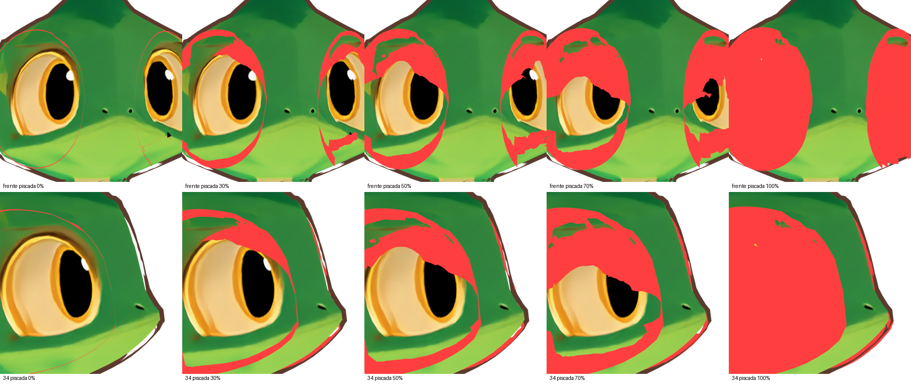

# Kumo — reestruturação do sistema ocular: diagnóstico e proposta

**Data:** 2026-11-10 · **Estado:** **proposta, aguardando aprovação**. Nenhum arquivo do modelo foi alterado: os hashes SHA-256 de `kumo_rigged.blend`, `kumo_quad.blend`, dos GLBs e do GLB original conferem. A inspeção foi feita numa cópia temporária, com a pálpebra pintada de vermelho só nessa cópia.

Ferramentas e dados: `src/inspect_eye.py`, `src/diag_blink.py`, `olhos-inspecao.json`.

## 1. Como os olhos estão construídos hoje

| Componente pedido | Situação atual |
|---|---|
| Órbita (cavidade) | Existe como relevo da malha da cabeça: uma reentrância onde fica o olho. Faz parte da malha única do corpo. |
| Globo ocular | **Não existe como geometria.** O "olho" é um trecho da própria pele da cabeça dentro da órbita. |
| Íris (âmbar), pupila, brilhos | **Pintados na textura da cabeça.** Não giram nem se movem. |
| Pálpebras superior e inferior | Objetos separados (`Kumo_Lid_L` e `Kumo_Lid_R`): uma grade plana de 450 vértices por olho, projetada de frente sobre a cabeça, presa ao osso da cabeça. A piscada usa uma única shape key. |

## 2. Causa exata das deformações

Pálpebra em vermelho, com a piscada em 0, 30, 50, 70 e 100%, nas vistas de frente e 3/4.

**C1. A pálpebra atravessa a cabeça no meio da piscada.** Uma shape key move cada vértice em linha reta, do estado aberto ao fechado, e alguns vértices percorrem até 0,54 H. A superfície embaixo é curva e afundada na órbita, então no caminho a pálpebra entra na cabeça:

| Piscada | Vértices da pálpebra E dentro da cabeça | Pálpebra D | Penetração máxima |
|---|---|---|---|
| 0% | 0 | 0 | — |
| 25% | 73 de 450 (16%) | 131 de 450 (29%) | 0,04 H |
| 50% | 59 (13%) | 121 (27%) | **0,06 H** |
| 75% | 17 | 89 | 0,03 H |
| 100% | 1 | 1 | — |

É exatamente o efeito de "superfície passando pelo olho": a pálpebra aparece em pedaços, entrando e saindo da pele.

**C2. Não existe globo ocular para a pálpebra contornar.** A pálpebra foi feita como uma grade plana projetada de frente, não como uma casca que segue a curvatura de um olho. Por isso ela não consegue "deslizar sobre o olho".

**C3. A pálpebra fechada é maior que o olho.** Ela cobre a órbita inteira, até a bochecha, e muda o contorno externo do olho, que você pediu para preservar.

**C4. No estado aberto, as fileiras ficam recolhidas na borda de cima, 1,2 cm fora da pele.** Isso produz o contorno fino visível em volta do olho em repouso (a linha vermelha na primeira imagem).

**C5. Só a projeção de frente.** Na 3/4 e no perfil, as bordas da pálpebra flutuam ou cortam a pele.

**C6. Íris e pupila pintadas:** é impossível dirigir o olhar.

## 3. Proposta de arquitetura (versão experimental `olhos-v1/`)

Princípio: **a malha da cabeça não é alterada** (a órbita e o relevo continuam exatamente como estão). Todo o sistema novo fica em **objetos próprios, presos ao osso da cabeça**.

### 3.1 Componentes

| Componente | Construção | Por que preserva a identidade |
|---|---|---|
| **Órbita** | A própria reentrância da malha atual, sem mudança | Relevo original 100% mantido |
| **Globo ocular** (`Kumo_Eye_L/R`) | Elipsoide vertical encaixado na órbita, com a frente coincidindo com a superfície do olho pintado e ajustado ao contorno visível por medição. Gira em torno do próprio centro. | Mesmo formato, dimensões e posição do olho atual; a distância entre os olhos não muda |
| **Esclera e anel âmbar** | Textura do globo **transferida (bake) do olho pintado atual** | A mesma cor âmbar e o mesmo creme, pixel por pixel |
| **Íris e pupila** (`Kumo_Iris_L/R`, `Kumo_Pupil_L/R`) | Calotas finas que seguem a curvatura do globo, presas a ele (decisão D5). Formato e tamanho medidos na pupila pintada. | A mesma pupila oval vertical; giram junto com o olhar |
| **Brilhos** (`Kumo_Catchlight_L/R`) | Pequenas malhas brancas **presas à órbita, não ao globo**. Reflexo de luz real não acompanha a rotação do olho. | Mesma posição dos brilhos atuais; dá vida ao olhar |
| **Pálpebra superior e inferior** | **Cascas esféricas concêntricas ao globo** (raio do globo mais uma pequena folga), na cor da pele amostrada, com linha escura na margem. Em repouso, ficam escondidas atrás da borda da órbita. | Ao fechar, **giram em torno do centro do globo** e por isso nunca atravessam o olho. O contorno externo do olho é sempre o da órbita. |

### 3.2 Movimento (ossos e controles)

Filhos do osso `head`:
- `eye.L` / `eye.R`: rotação de cada globo, com íris e pupila presas.
- `eye_target` (com `eye_target.L` / `eye_target.R`): alvo de olhar à frente do rosto, com *Damped Track*. Mover o alvo dirige os dois olhos juntos; os sub-alvos fazem ajustes individuais. Rotação direta também possível.
- `lid_up.L/R` e `lid_low.L/R`: ossos com pivô **no centro do globo**. A pálpebra superior desce girando sobre a curvatura, e a inferior sobe.
- **Propriedades de controle**, com drivers, no osso `head`:
  - `piscar` (os dois olhos, de 0 a 1);
  - `piscar_E` e `piscar_D` (individuais);
  - `fechar_parcial_E` e `fechar_parcial_D` (semicerrar, por exemplo desconfiado);
  - `acompanhar_olhar` (as pálpebras acompanham um pouco o olhar vertical, para parecer natural).
- **Shape keys corretivas** nas pálpebras, se necessário, para a linha do olho fechado ter a curva desenhada.
- Como tudo é filho do osso da cabeça, **os olhos acompanham qualquer movimento da cabeça** sem sair do lugar.

### 3.3 O que **não** muda

A forma, as dimensões e a posição dos olhos, a distância entre eles, a cor âmbar, o formato da pupila, a malha da cabeça, a textura e o restante do rig. As pálpebras antigas ficam na cena, ocultas, só para comparação.

## 4. Entregáveis da versão experimental (após aprovação)

Pasta `kumo-3d-rodin/olhos-v1/`, com o script, `kumo_eyes_exp.blend` e as renders:

1. Olhos totalmente abertos (deve ficar idêntico ao atual).
2. Olhos parcialmente fechados (30% e 60%).
3. Olhos completamente fechados.
4. Piscada individual (E e D).
5. Olhar: esquerda, direita, cima e baixo.
6. Cabeça girando com os olhos e as pálpebras acompanhando.
7. Medições:
   - penetração das pálpebras ao longo de toda a piscada, com meta de **0 vértices dentro do globo ou da cabeça**;
   - semelhança do olho aberto com o atual;
   - posição e distância dos olhos antes e depois.

## 5. Decisões pedidas

- **(A) Malha da cabeça:** manter intacta, com o globo encaixado na órbita existente (**recomendado**, preserva 100% do relevo). A alternativa é aprofundar a órbita na malha, que daria mais espaço para o globo girar mas altera a cabeça.
- **(B) Brilhos:** presos à órbita, sem girar com o olho (**recomendado**, mais natural). A alternativa é presos ao globo.
- **(C) Autorização** para criar a versão experimental `olhos-v1/`. A versão atual não é tocada.
