# Relatório de inspeção de topologia — malha retopologizada do Kumo

**Data:** 2026-11-10 · **Objeto:** `Kumo` em `kumo-3d-rodin/kumo_rigged.blend` (malha em quads do QuadriFlow, com rig) · **Natureza:** **somente inspeção. Nenhum vértice, aresta, face ou material foi alterado.**

## 0. Garantia de integridade

- A análise rodou sobre uma **cópia temporária** do `.blend`, que nunca foi salva. As imagens foram feitas com **objetos duplicados criados só na memória**.
- Hashes SHA-256 conferidos antes e depois: idênticos.

| Arquivo | SHA-256 |
|---|---|
| `kumo_rigged.blend` | `4a374f56…3d86` |
| `kumo_quad.blend` | `0907f0ff…628e` |
| `export/kumo_rigged.glb` | `58c5e5e6…ae13` |
| `export/kumo_quad.glb` | `7a9a17da…bc81` |
| `base_basic_pbr.glb` | `c1365d76…6896` |

- **Ferramenta:** `inspecao/src/inspect_topology.py`. **Dados brutos:** `inspecao/topology.json`.
- **Legenda das imagens:** malha em cinza com as arestas em preto; **azul** = polo de 3 arestas (N-pole), **vermelho** = polo de 5 arestas (E-pole); amarelo = triângulo (não há nenhum).

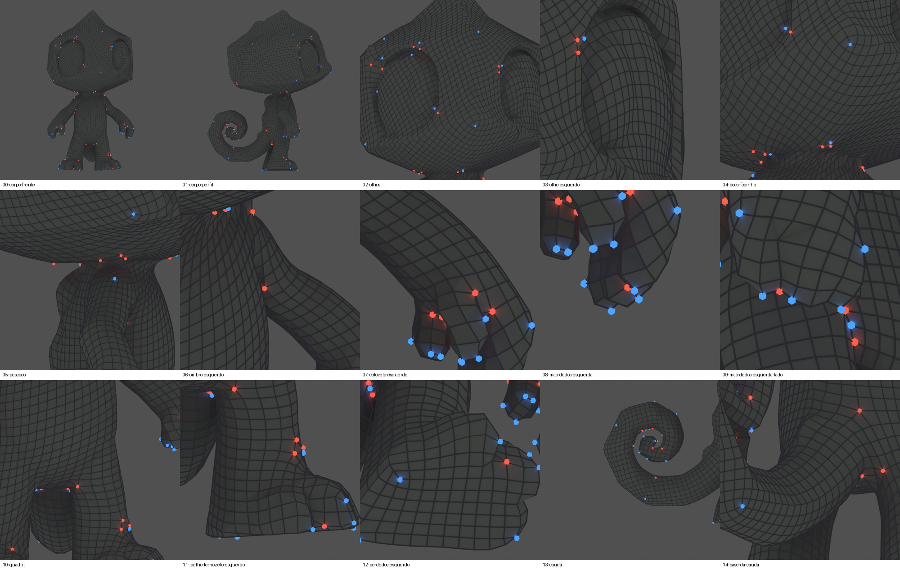

## 1. Visão geral

| Métrica | Valor | Avaliação |
|---|---|---|
| Vértices / arestas / faces | 7.398 / 14.792 / 7.396 | — |
| Quads | **100%** (sem triângulos, sem n-gons) | Excelente |
| Faces degeneradas / arestas de comprimento zero | 0 / 0 | Excelente |
| Arestas não-manifold / de borda / vértices soltos | 0 / 0 / 0 | Malha fechada e estanque |
| Enrolamento inconsistente | 0 | Normais coerentes |
| Volume com sinal | +0,676 | **Normais para fora** |
| Valência dos vértices | 3: 87 · 4: 7.232 · 5: 79 · 6 ou mais: 0 | 166 polos, todos leves (nenhum de 6+) |
| Inclinação dos quads (desvio de 90°) | média 16,3°; 918 acima de 30°; **320 acima de 45°** | Moderado |
| Proporção dos quads | 74 acima de 3:1; 9 acima de 5:1 | Bom |
| Quads não planos (acima de 5% do lado) | 721 (9,7%) | Atenção para o sombreamento |
| Ângulo entre faces vizinhas | 366 arestas acima de 60°; **101 acima de 90°**; máximo 173° | Dobras fortes (órbitas e reentrâncias) |
| Sombreamento | 7.396 faces suaves, 0 planas, 0 arestas vivas | **Conflita com a identidade facetada** |
| Influências de osso por vértice | até **10**; **534 vértices com mais de 4** | Risco de exportação para jogos |

**Diagnóstico geral:** a malha é **tecnicamente limpa** (100% quads, fechada, normais corretas, nenhuma geometria degenerada). O problema é **estrutural**: o QuadriFlow gera uma **grade uniforme que segue a curvatura da superfície, não a anatomia**. Não existem anéis de arestas concêntricos nos olhos e na boca, nem anéis de articulação desenhados para dobrar. Isso não atrapalha o modelo parado, mas **limita a qualidade da deformação** na animação.

## 2. Região por região

Escala de gravidade: 🟢 baixa · 🟡 média · 🟠 alta · 🔴 crítica (impede o uso pretendido).

### 2.1 Olhos — 🟠 alta (para animação facial)
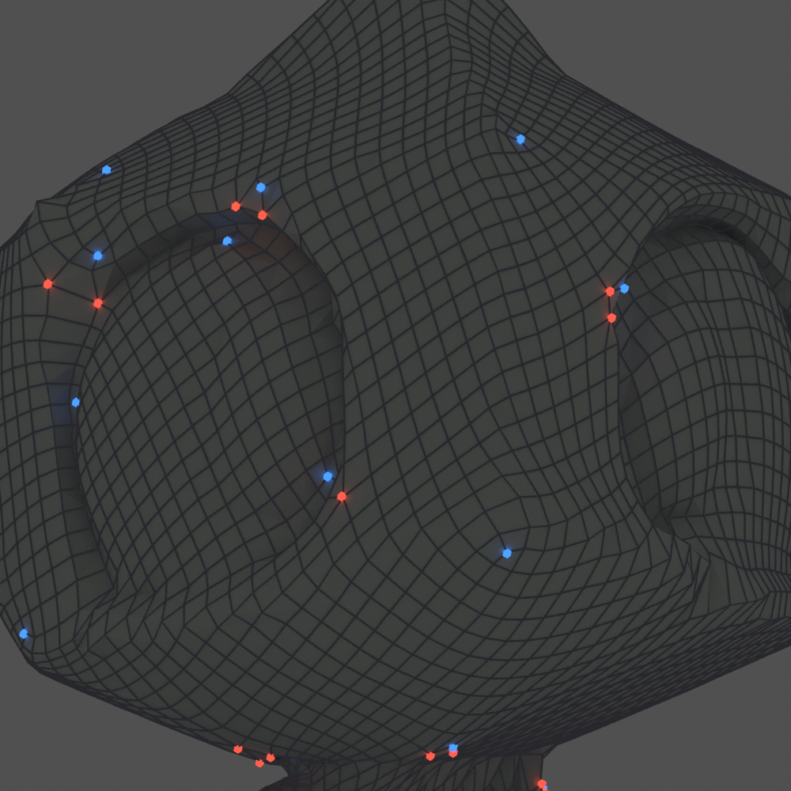 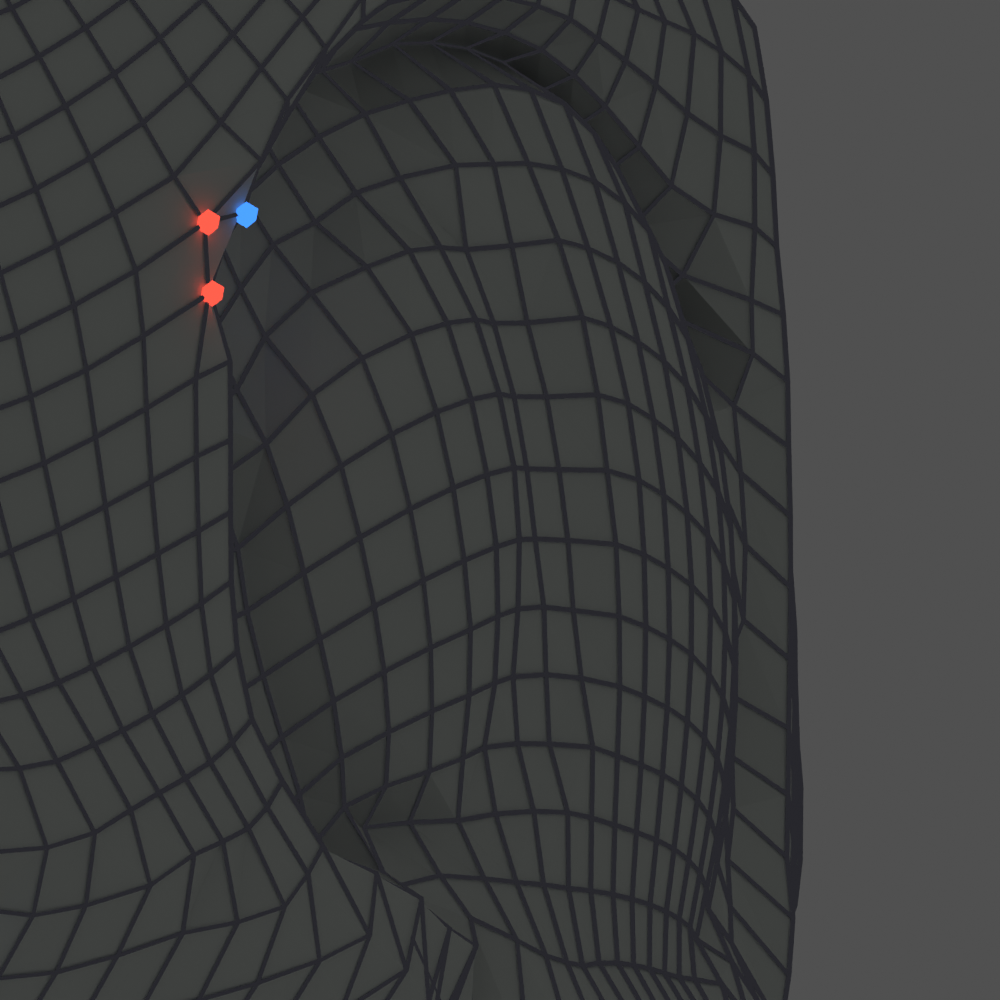

| | Olho E | Olho D |
|---|---|---|
| Faces na região | 1.118 (100% quads) | 1.227 (100% quads) |
| Polos 3 / 5 | 8 / 6 | 12 / 9 |
| Arestas radiais / concêntricas / diagonais | 35% / **21%** / 44% | 40% / **27%** / 33% |
| Inclinação média; acima de 30° | 20,4°; 199 | 18,3°; 196 |

- **Não há anéis concêntricos** em volta do olho: só 21–27% das arestas contornam o olho, e o resto cruza a borda na diagonal ou na radial.
- **O olho é um relevo da própria pele**, pintado na textura. Não há globo separado nem pálpebra na malha do corpo: as pálpebras atuais são objetos à parte.
- **A cavidade da órbita é profunda**, com quads esticados na parede e dobras acima de 90°. É onde estão boa parte das 101 arestas de dobra forte.
- **Polos agrupados** nos cantos superiores da órbita.
- **Consequências:**
  - Formas de olho (arregalar, apertar, olho de riso) feitas com shape keys na pele vão **serrilhar e "nadar" a textura**.
  - O olhar não pode mudar de direção, porque a pupila está pintada.
  - A piscada só funciona com as pálpebras externas.

### 2.2 Boca e focinho — 🟠 alta
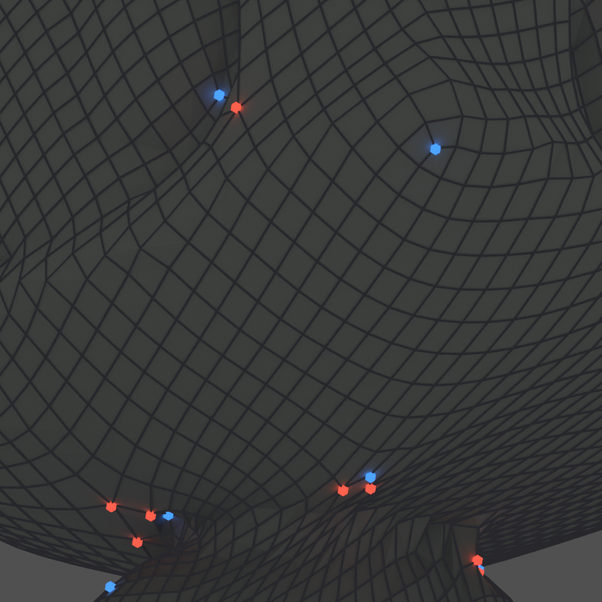

- **Região:** 122 faces, 100% quads, polos 2 / 1, inclinação média 15,5°.
- **Fluxo:** 44% radial, **15% concêntrico**, 41% diagonal.
- **A boca é só pintada na textura:** não há linha de lábio na malha, nem anéis de lábio ou cavidade. A grade passa por cima da linha da boca na diagonal.
- **Polos agrupados embaixo do queixo**, na junção cabeça-pescoço.
- **Consequência:** **é impossível abrir a boca ou articular fala sem refazer a topologia local.** Shape keys de sorriso só esticariam a textura.

### 2.3 Pescoço e junção cabeça-corpo — 🟠 alta
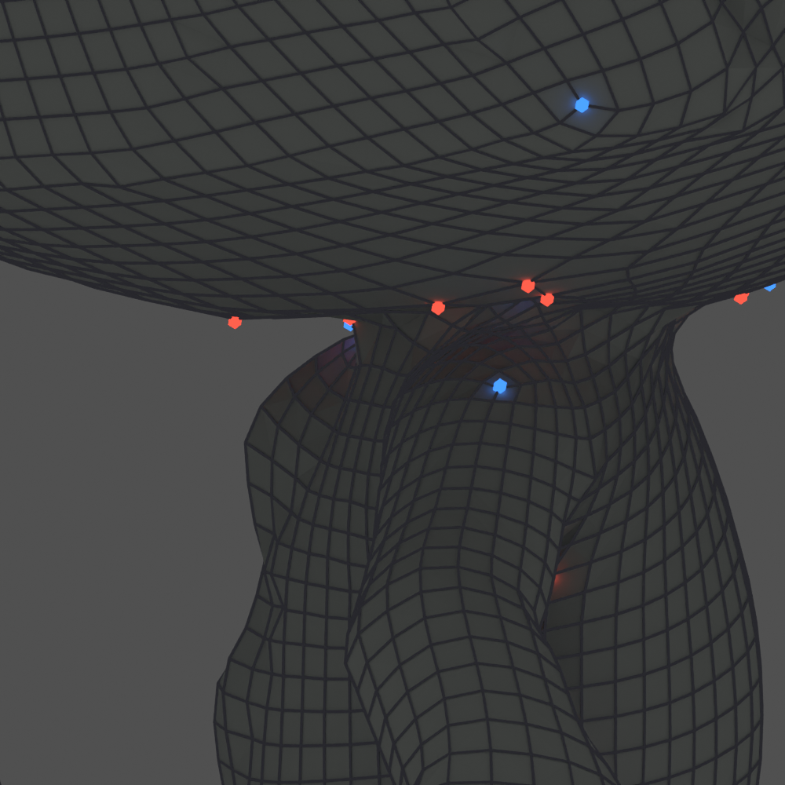

- **Região:** 432 faces, 100% quads, polos 4 / 9 (a maior concentração de polos de 5 do corpo).
- **Inclinação média de 33,1°**, a pior região do corpo; 207 quads acima de 30°.
- **Fluxo:** 11% ao longo do osso, 34% em volta, **54% diagonal**. A seção transversal tem 40 arestas.
- A cabeça se projeta sobre o pescoço, formando uma **aba côncava profunda** sob o queixo.
- **Consequência:** ao girar ou inclinar a cabeça, a pele sob o queixo tende a **se comprimir e atravessar a si mesma**, com sombreamento manchado nos polos. No teste de giro de 25°, o resultado ficou aceitável, mas acenos maiores (para cima e para baixo) são arriscados.

### 2.4 Ombros — 🟡 média (E) / 🟠 alta (D)
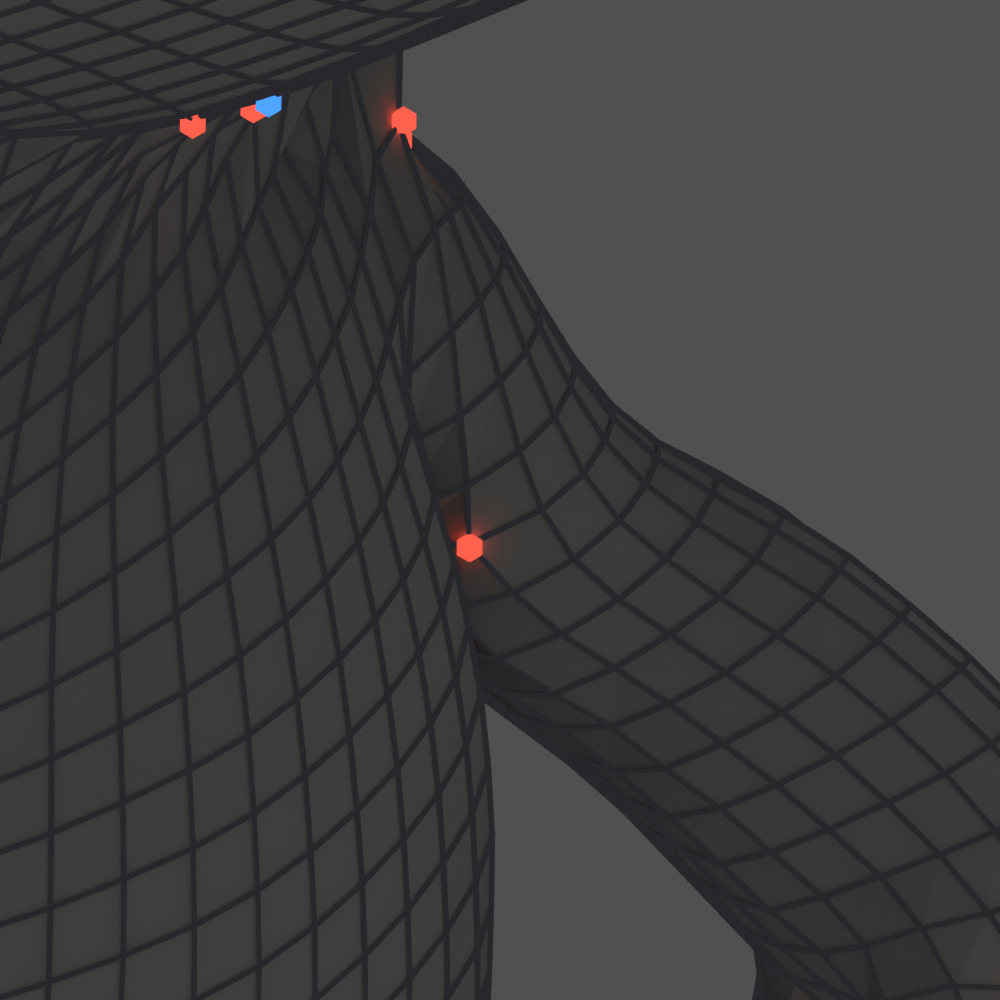

| | Ombro E | Ombro D |
|---|---|---|
| Seção transversal | 31 arestas | **16 arestas** |
| Fluxo ao longo / em volta / diagonal | 50% / 29% / 21% | 28% / 34% / **38%** |
| Polos 3 / 5 | 0 / 1 | 1 / 2 |

- **Assimetria:** o lado direito tem metade da resolução e mais fluxo diagonal. O QuadriFlow aplicou a simetria só em parte.
- **Não há anel de deltoide.**
- **Consequência:** confirma o que o teste de aceno mostrou: com o braço levantado a 75°, **108 faces dobraram** no ombro. Levantar o braço acima de cerca de 45° vai amassar o ombro, principalmente o direito.

### 2.5 Cotovelos e punhos — 🟡 média
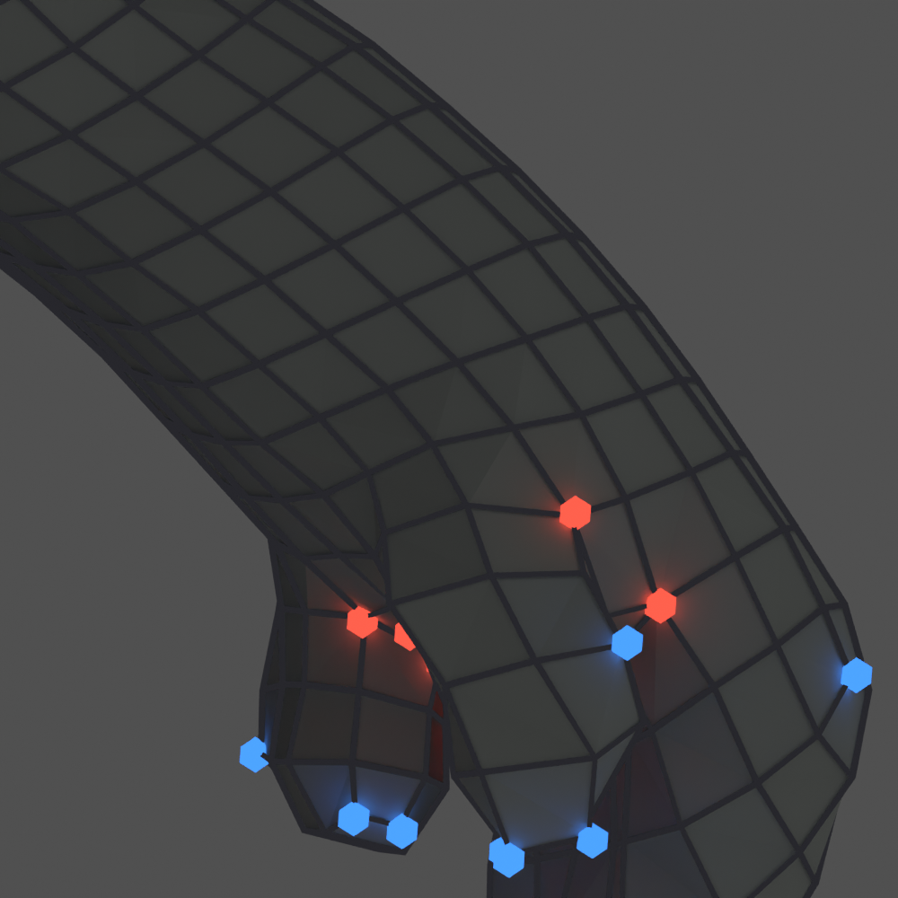

- **Cotovelo E:** polos 1 / 6, fluxo diagonal de 18%, seção de 25 arestas. **Cotovelo D:** polos 1 / 2, diagonal de 5%, seção de 19 arestas.
- **Os polos de 5 no cotovelo esquerdo ficam justamente na dobra**, o pior lugar possível.
- **Punhos:** só 14 a 21 arestas por seção e 38–41% de fluxo diagonal.
- Nenhum dos dois tem o padrão de 3 anéis em pinça.
- **Consequência:** dobras de cotovelo acima de cerca de 60° devem mostrar **perda de volume** (efeito "mangueira dobrada") e artefatos de sombreamento nos polos.

### 2.6 Mãos e dedos — 🔴 crítica (para animar os dedos)
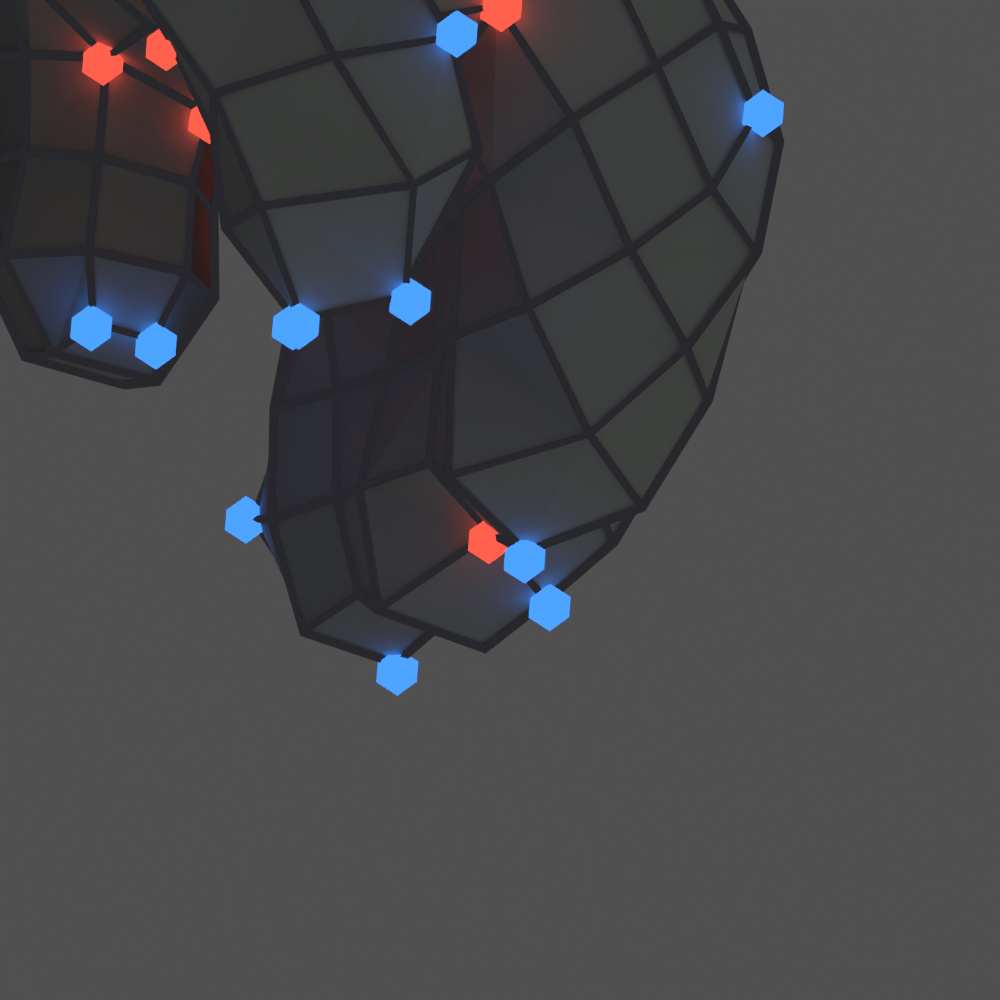 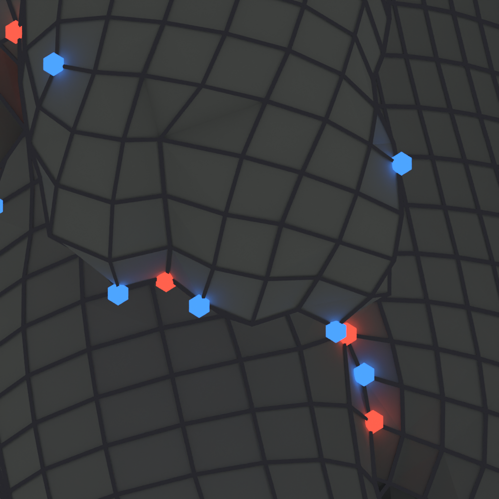

| | Mão E | Mão D |
|---|---|---|
| Faces na geometria da mão | 18 | 14 |
| Polos 3 / 5 | 4 / 1 | 3 / 0 |
| Dígitos separados detectados em cortes horizontais | até 6 | até 5 |
| **Comprimento do osso da mão** | **0,034** | 0,109 |
| **Vértices com o osso da mão como principal** | **5** | **1** |

- **Os dedos têm só 2 a 3 quads de circunferência** e quase nenhum anel ao longo do comprimento. Não é possível dobrá-los.
- **Polos de 3 nas pontas** dos dedos: esperado em pontas, sem impacto.
- **Achado de rig, não de malha:** o osso da mão esquerda ficou com apenas 0,034 de comprimento, e as duas mãos estão pesadas quase só no antebraço.
- **Consequência:**
  - Hoje a mão inteira é rígida e acompanha o antebraço.
  - Não há como abrir, fechar ou apontar.
  - O polegar opositor da referência não é articulável.

### 2.7 Quadris e virilha — 🟡 média
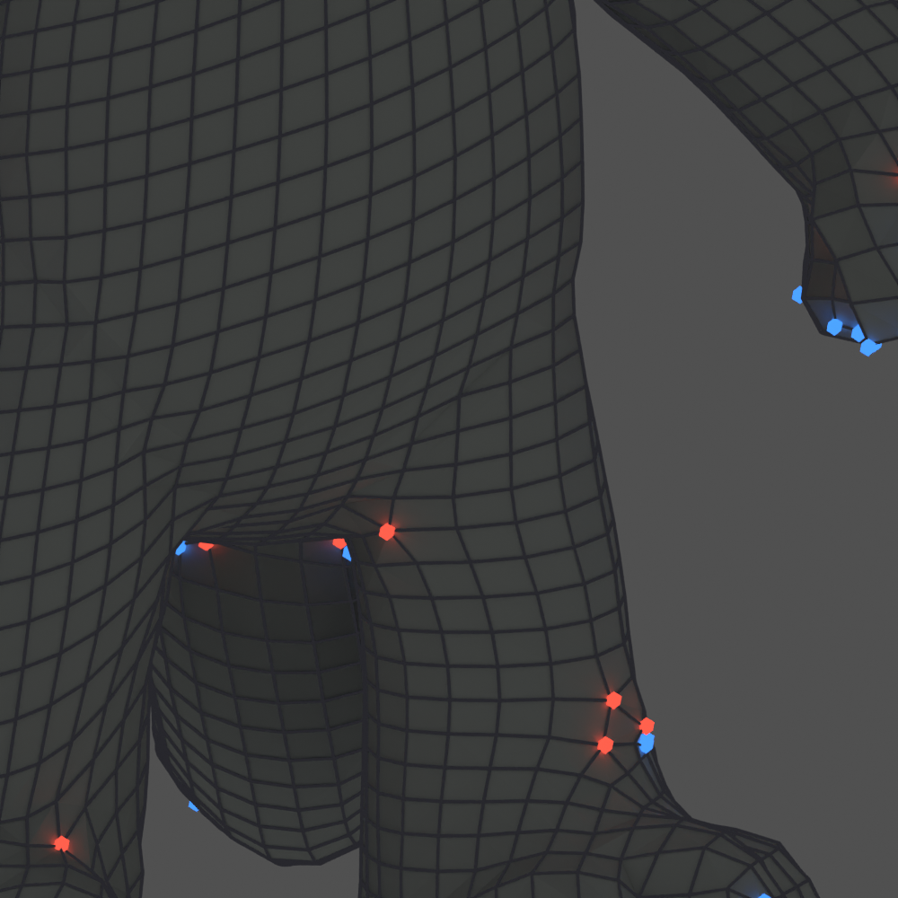

- **Quadril E:** seção de **12 arestas** (baixa), polos 2 / 4, diagonal de 19%. **Quadril D:** seção de 15, polos 0 / 2.
- **Polos de 5 na virilha**, entre as pernas.
- **Consequência:** abrir as pernas ou levantar o joelho deve **comprimir a virilha** e aproximar a coxa da barriga. Passos normais (teste "passo") ficaram limpos.

### 2.8 Joelhos e tornozelos — 🟡 média (E) / 🟠 alta (joelho D)
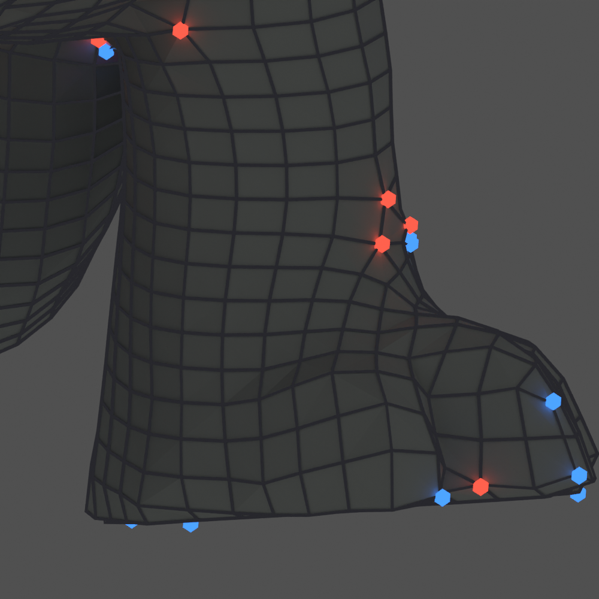

- **Joelho E:** diagonal de 50%, polos 1 / 0. **Joelho D: 67% diagonal**, o fluxo mais desalinhado das articulações.
- **Tornozelos:** diagonal de 40–53%, polos 2–1 / 2–3.
- **Consequência:** dobrar o joelho direito deve gerar **torção visível** da malha ("efeito parafuso") e perda de volume.

### 2.9 Pés e dedos dos pés — 🟢 baixa (personagem não articula dedos dos pés)
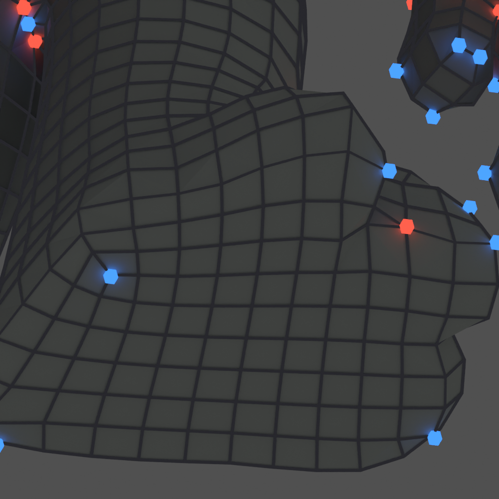

- **Quads:** 156 (E) e 188 (D). **Polos:** 5 / 1 (E) e 6 / 3 (D), concentrados nas pontas dos dedos, que é aceitável.
- **Fluxo:** 34–28% diagonal.
- Os 3 dedos frontais são **relevos do pé**, sem divisão entre eles.
- **Consequência:** o pé funciona como bloco rígido (andar e apoiar). Para curvar os dedos, faltaria resolução.

### 2.10 Cauda — 🟢 baixa a 🟡 média (na ponta)
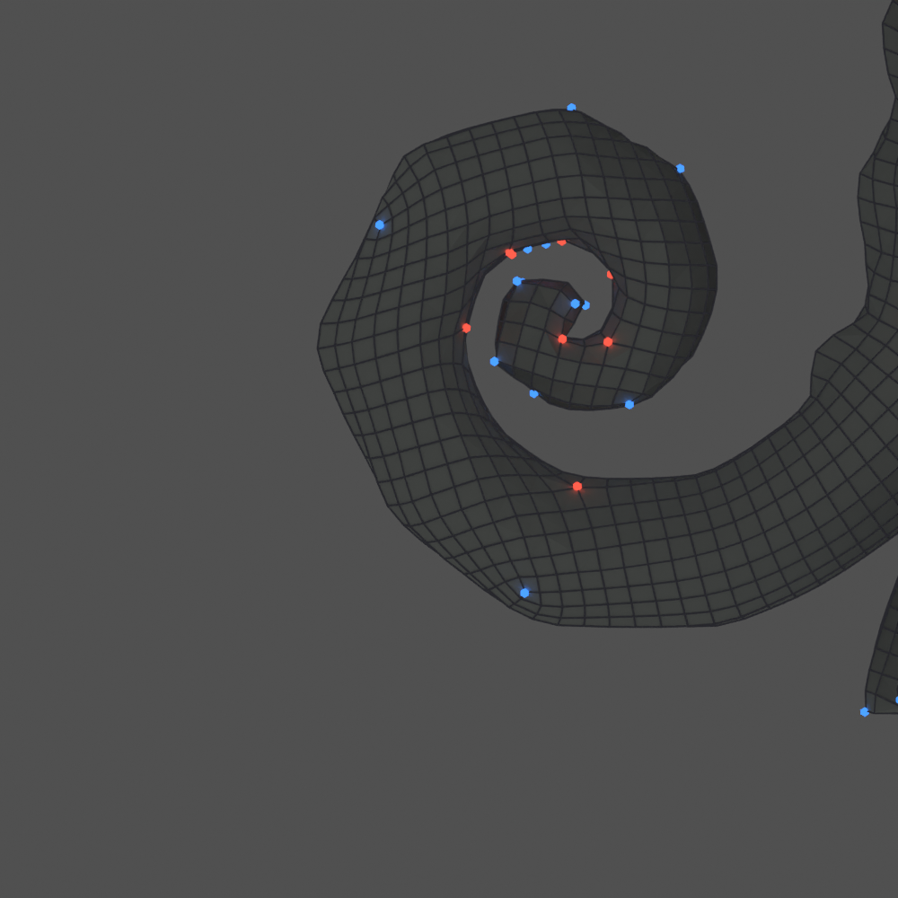 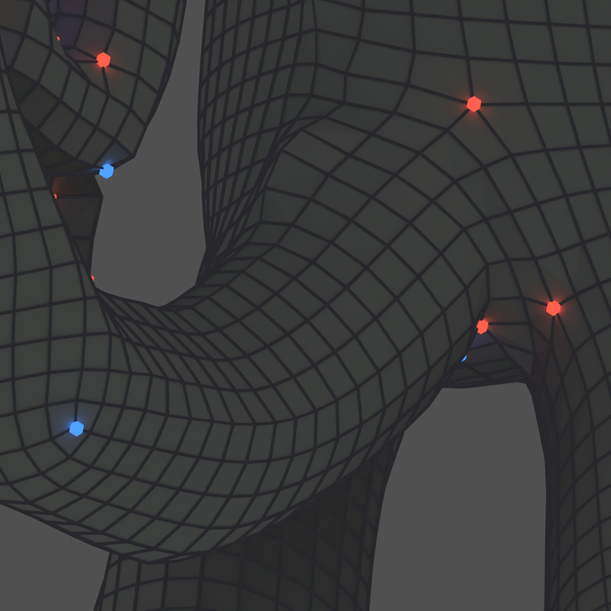

- **Região:** 1.059 faces, 100% quads, polos 18 / 15, inclinação média **11,7°** (a melhor região do corpo).
- **Fluxo:** 31% ao longo, 40% em volta e 29% diagonal. Seção de 29 arestas.
- **Por segmento (diagonal):** tail_01 a tail_04 com 0–17%, **ótimo**; tail_05 a tail_08 com 24–36%; **tail_09 com 65%** e tail_10 com 25%.
- **Polos agrupados no fim da espiral** e na junção da base com o corpo.
- **Consequência:** a cauda é a parte **mais preparada para deformar**. O teste de enrolar teve 0 faces invertidas. A ponta (tail_09) tende a torcer se for animada separadamente.

## 3. Normais e sombreamento

- **Normais:** coerentes e para fora em 100% da malha, sem nenhuma aresta com enrolamento inconsistente. **Nenhum problema de orientação.**
- **Sombreamento suave em todas as faces e nenhuma aresta viva:** a superfície "lisa" contradiz a identidade **facetada e angular** do Kumo. Com o material de cor chapada (emissão) usado na cena, isso quase não aparece. Com iluminação real (PBR em motor de jogo), os planos da cabeça vão parecer **arredondados**.
- **721 quads não planos e 101 dobras acima de 90°** (órbitas, sob o queixo, virilha) podem produzir **manchas de sombreamento** com luz real e no cel-shading com faixas de luz.

## 4. Prontidão para animação

| Uso | Situação |
|---|---|
| Corpo: andar, girar a cabeça, gestos moderados de braço (até cerca de 45°), cauda | 🟢 **Pronto** (testes limpos) |
| Braços acima da cabeça, acenos amplos | 🟠 Ombro amassa (108 faces no teste) |
| Dobras fortes de cotovelo e joelho | 🟡 Perda de volume e torção (joelho D) |
| Abrir, fechar e apontar com os dedos | 🔴 **Não suportado** (resolução e rig da mão) |
| Piscar | 🟢 Funciona com as pálpebras externas |
| Olhar em direções diferentes | 🔴 **Não suportado** (pupila pintada) |
| Abrir a boca, falar, sorrir | 🔴 **Não suportado** (boca pintada, sem anéis de lábio) |
| Exportar para motores de jogo (limite de 4 influências por vértice) | 🟠 534 vértices passam do limite; o motor vai descartar pesos |

## 5. Resumo dos problemas por gravidade

| # | Gravidade | Região | Problema | Consequência |
|---|---|---|---|---|
| 1 | 🔴 | Mãos | Dedos com 2–3 quads de volta; osso da mão E com 0,034; dedos pesados no antebraço | Dedos não articulam |
| 2 | 🔴 | Boca | Sem geometria de boca nem anéis de lábio | Sem fala nem boca aberta |
| 3 | 🔴 | Olhos | Pupila e íris pintadas; sem anéis concêntricos | Sem olhar dirigido; formas de olho serrilham |
| 4 | 🟠 | Pescoço | 54% de fluxo diagonal, inclinação de 33°, 9 polos de 5 | Compressão sob o queixo em acenos |
| 5 | 🟠 | Ombro D | Metade da resolução do E, 38% diagonal | Amassamento ao levantar o braço |
| 6 | 🟠 | Joelho D | 67% de fluxo diagonal | Torção ao dobrar |
| 7 | 🟠 | Rig e exportação | Até 10 influências; 534 vértices acima de 4 | Pesos cortados no motor de jogo |
| 8 | 🟡 | Cotovelo E | Polos de 5 na dobra | Artefatos de sombreamento na dobra |
| 9 | 🟡 | Quadris e virilha | Seção de 12–15 arestas; polos de 5 | Compressão em poses amplas |
| 10 | 🟡 | Superfície | Sombreamento todo suave, sem arestas vivas; 721 quads não planos | Facetas suavizadas com luz real |
| 11 | 🟢 | Cauda (ponta) | tail_09 com 65% diagonal | Leve torção na ponta |
| 12 | 🟢 | Pés | Dedos sem divisão | Pé rígido (aceitável) |

Nenhuma correção foi feita, conforme solicitado. As propostas de correção podem ser apresentadas numa etapa seguinte, mediante aprovação.
