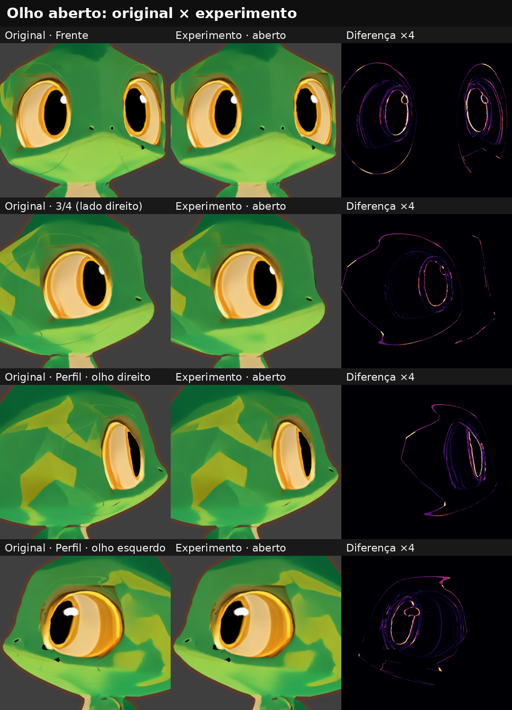
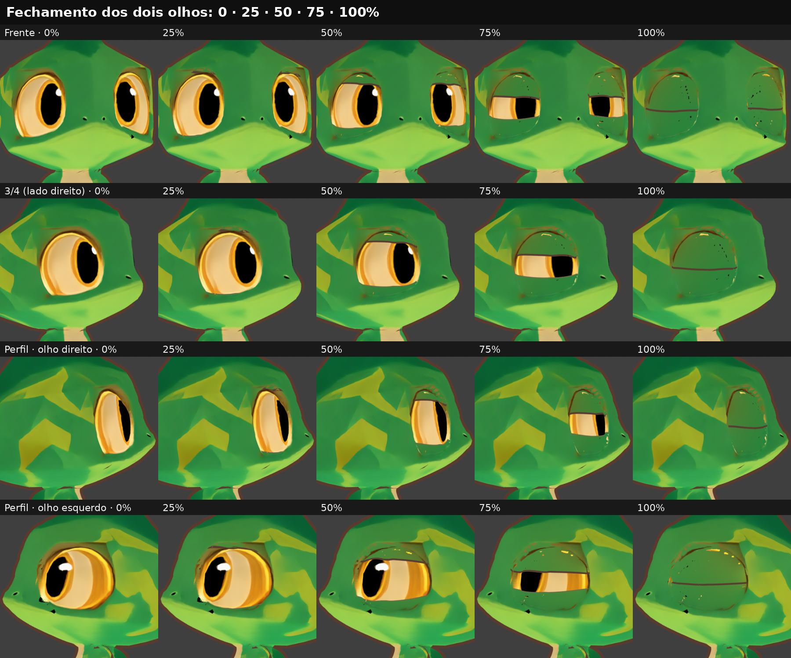
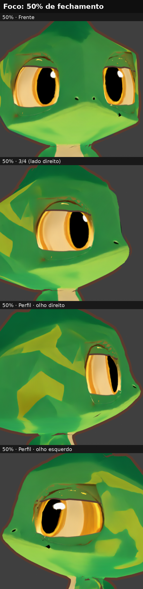
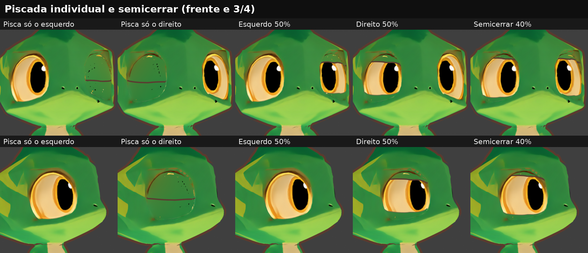
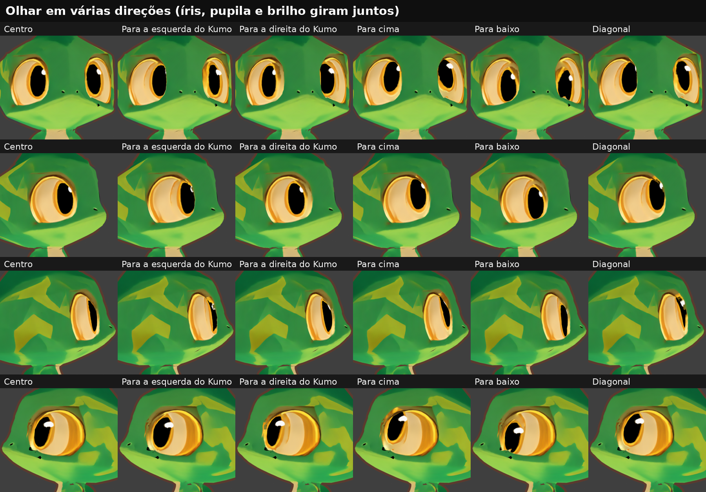
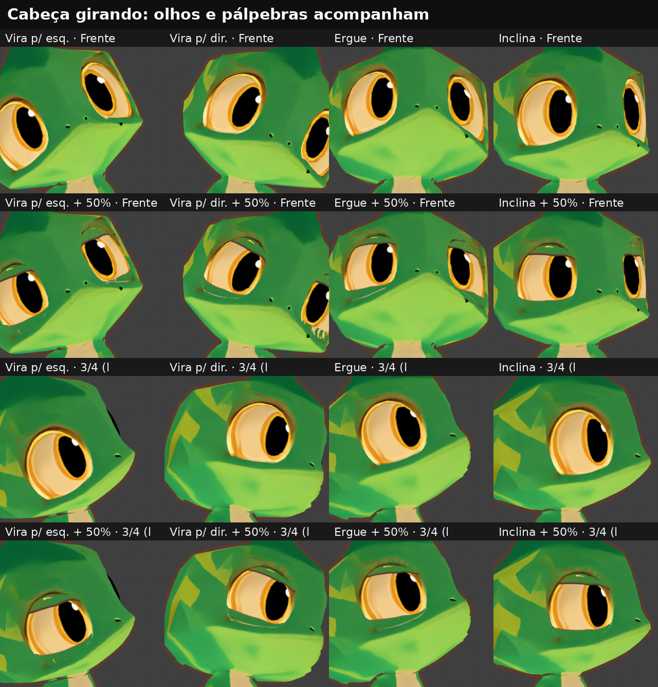

# Kumo · olhos-v1: resultados da versão experimental

**Data:** 2026-11-10 · **Estado:** **para avaliação do Caio.** Não está aprovado; este relatório não se autoaprova.

Objetos, ossos e controles estão no [`README.md`](README.md).

## Condições pedidas

| Condição | Situação | Como foi verificado |
|---|---|---|
| 1. Originais sem alterações | ✅ | SHA-256 de `kumo_rigged.blend`, `kumo_quad.blend`, dos dois GLBs exportados e do GLB original conferem antes e depois |
| 2. Trabalhar só em cópias | ✅ | Tudo em `olhos-v1/`; o original é aberto só para leitura |
| 3. Não sobrescrever materiais, texturas ou configurações aprovadas | ✅ | Só materiais e texturas novos. Única mudança de cena na cópia: `transparent_max_bounces` 8 → 24 |
| 4. Formato, dimensões, cores e posição dos olhos | ✅ | Ver "Olho aberto" abaixo |
| 5. Silhueta externa da cabeça | ✅ | Malha da cabeça idêntica (mesmo hash de vértices e faces, mesmos modificadores); IoU da silhueta do corpo entre 0,9998 e 1,0 |
| 6. Documentar objetos e controles | ✅ | `README.md` |

## 1. Olho aberto (identidade)

| Vista | Diferença média na região dos olhos (0–255) | Pixels com diferença > 48 | Posição do olho (deslocamento) |
|---|---|---|---|
| Frente | 4,5 | 2,0% | ≤ 0,4 px |
| 3/4 | 1,7 | 0,3% | 0,3 px |
| Perfil, olho direito | 4,3 | 1,8% | 0,7 px |
| Perfil, olho esquerdo | 2,8 | 0,9% | 0,2 px |

A distância entre os olhos na frente é de 326,0 px antes e 326,5 px depois (0,5 px a 560 px de imagem, cerca de 1 mm). As diferenças que restam ficam só nas bordas suavizadas da pupila e do contorno. Some também a linha fina que as pálpebras antigas deixavam em volta do olho aberto (defeito C4 da proposta).

Silhueta do corpo inteiro: IoU de 0,99979 (frente), 0,99984 (3/4), 1,0 (perfil) e 0,99987 (costas), com 19 a 30 pixels de diferença em imagens de 700 px.

## 2. Penetração das pálpebras e camadas

Método:
- Cada vértice de cada objeto novo é testado contra a cabeça deformada, nos mesmos triângulos que o Blender renderiza.
- "Dentro da cabeça" é decidido por paridade de raios em duas direções, confirmada com nove direções nos casos duvidosos.
- Também é contado todo vértice de pálpebra que passe **por baixo do globo**.
- "Visível" significa sobre a superfície do olho e dentro do contorno.
- As piscadas foram testadas em 81 passos (de 1,25 em 1,25%), incluindo os pontos **entre** os estágios das shape keys, que são o pior caso.

| Caso | Passos | Máx. penetrações visíveis | Em 50% |
|---|---|---|---|
| Piscada simultânea | 81 | **0** | 0 |
| Piscada só do esquerdo | 81 | **0** | 0 |
| Piscada só do direito | 81 | **0** | 0 |
| Semicerrar os dois | 42 | **0** | 0 |
| Piscar olhando para a esquerda / direita | 42 | **0** | 0 |
| Piscar olhando para cima / para baixo | 42 | 1 / 1 (pálpebra sob o globo, sem entrar na cabeça) | 0 |
| **Teste extra:** piscar com o osso da cabeça girado 25° | 42 | 22 (pior: 5,1 mm a 71%) | 2–7 |
| **Teste extra:** piscar com a cabeça inclinada | 42 | 17 (quase todos pálpebra sob o globo) | 12–14 |
| **Teste extra:** olhar na diagonal + cabeça girada | 42 | 10 | 2–5 |

Fora do contorno ficam de 1 a 3 vértices ocultos dentro da cabeça. São a parte da pálpebra recolhida atrás da órbita, invisível em qualquer vista.

**Deformação da cabeça:** zero. A malha avaliada da cabeça é idêntica com o olho aberto, fechado ou olhando para o lado (diferença máxima de 0,0 m).

## 3. Fechamento e 50%

## 4. Piscada individual, olhar e cabeça

Animação da piscada (3/4): `renders/07-piscada-animada.gif`. Cada render isolado está em `renders/estados/`.

## 5. O que ainda não está bom (para sua avaliação)

1. **Pontinhos alaranjados e escuros na pálpebra perto da borda de cima.** São visíveis a 50%, 75% e 100%, principalmente no perfil do olho esquerdo. É cor, não geometria: a pele da pálpebra é amostrada da textura em volta do olho, e nessa faixa a textura original tem os traços pintados acima do olho. Correção possível: cor de pele lisa em toda a pálpebra, sem a textura real na faixa da borda.
2. **Contorno do olho aparecendo com o olho fechado.** É a linha pintada na pele da cabeça em volta do olho. Ela pertence à textura aprovada, então não foi apagada. Correção possível: a pálpebra fechada cobrir um pouco além do contorno. Isso só é invisível com o olho aberto se a cor da borda bater, e depende do item 1.
3. **Cabeça girada pelo osso (teste extra, além do pedido).** Em giros de 18° a 25° aparecem pontos onde a pálpebra passa sob o globo, e um caso de 5,1 mm a 71% de fechamento. A causa está no rig aprovado: em volta dos olhos a pele mistura os ossos `head` e `neck` (peso de pescoço de 0 a 0,05). Ao girar só a cabeça, regiões vizinhas da pele deslizam entre si alguns milímetros. Uma guarda de colisão já reduziu o defeito de 94 para poucos vértices. Para zerar há duas opções:
   - deixar a região dos olhos 100% `head` no rig, o que **altera os pesos aprovados da cabeça** e precisa de autorização;
   - aceitar o resíduo e corrigir com a guarda mais forte, o que deixa a pálpebra um pouco mais alta nessas poses.
4. **Amplitude do olhar.** Os olhos do Kumo são rasos. Acima de cerca de 11° a pupila encosta no contorno e é cortada (testado a ±20°). Os testes usam ±11° horizontal e ±9° vertical.

## Decisões pedidas

- **(A)** O resultado com a cabeça em repouso (abertura, piscadas, olhar, vistas de frente, 3/4 e perfil) atende?
- **(B)** Corrigir os itens 1 e 2 com pele lisa na pálpebra?
- **(C)** Item 3: autorizar que a região dos olhos fique 100% `head` no rig, ou manter os pesos e reforçar a guarda?
