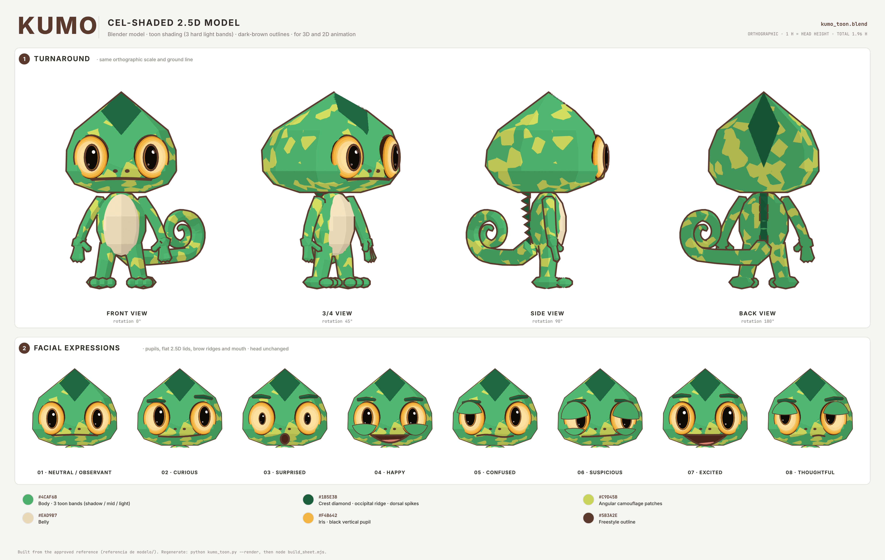

# Kumo — modelo 2,5D com cel-shading (toon shading)

Modelo 3D do Kumo feito no Blender e renderizado com **cel-shading**: luz em faixas chapadas, facetas planas da cabeça poliédrica e contorno marrom-escuro (`#5B3A2E`). Ele parece desenho 2D, mas é um modelo 3D de verdade. Serve para animação 3D e também para gerar quadros 2D de qualquer ângulo.

Construído a partir da referência aprovada em [`../referencia de modelo/`](../referencia%20de%20modelo/). As proporções foram medidas nas silhuetas de frente, perfil e costas da referência.



## Arquivos

| Arquivo | Conteúdo |
|---|---|
| `kumo_toon.blend` | Cena do Blender: modelo, materiais toon, contorno Freestyle, câmeras ortográficas (frente, 3/4, perfil, costas, rosto) |
| `renders/view-*.png` | Turnaround, 1400 × 1400, fundo transparente |
| `renders/expr-*.png` | As 8 expressões, 840 × 840, fundo transparente |
| `kumo-toon-sheet.png` / `.svg` | Ficha com o turnaround e as expressões |
| `src/kumo_toon.py` | Gera o modelo inteiro por código (fonte do `.blend`) |
| `src/build_sheet.mjs` | Monta a ficha a partir dos renders |

## Como funciona

- **Cabeça:** um poliedro facetado (envoltória convexa) com as medidas da referência: altura de 1 H, largura de 1,09 H e profundidade de 1,2 H. A crista é um losango verde-escuro que desce até entre os olhos, com uma faixa na nuca.
- **Shader toon:** usa só emissão. A posição de cada faceta em relação a uma luz fixa vira 4 tons chapados. As manchas de camuflagem são angulares (Voronoi). A barriga é bege.
- **Contorno:** feito com Freestyle, em marrom-escuro.
- **Expressões:** um controle das pupilas por olho (posição e tamanho), pálpebras planas no estilo 2,5D, cristas de sobrancelha e uma boca para cada expressão, projetada sobre o rosto.
- **Medidas:** 1 H = altura da cabeça. O chão fica em z = 0 e a ponta da crista em z = 1,96.

## Regenerar

```bash
python3 -m venv venv && venv/bin/pip install bpy==5.2.3 pillow   # ou use o Blender: blender -b -P src/kumo_toon.py -- ...
venv/bin/python src/kumo_toon.py --out . --render --res 1400
node src/build_sheet.mjs
node ../character-model-sheet/src/render.cjs kumo-toon-sheet.svg kumo-toon-sheet.png 2
```

No Blender, abra `kumo_toon.blend` e renderize com o Cycles (as câmeras já estão prontas). Para trocar de expressão, rode o script com outra expressão ou mova os objetos `Kumo_PupilRig_*`, `Kumo_Lid*`, `Kumo_Brow_*` e `Kumo_Mouth_*`.

## Diferenças conhecidas em relação à referência

- No perfil, o olho fica um pouco saliente da silhueta. Na referência ele fica dentro do contorno.
- Nas costas, a espiral da cauda aparece do lado esquerdo, que é o fisicamente correto num modelo 3D. A referência desenha do lado direito.
- Mãos e pés estão simplificados, mas mantêm 3 dedos + polegar e 3 dedos nos pés.
- **Ainda não há esqueleto (rig) para animação.** O próximo passo para animar é adicionar uma armature com pesos.
