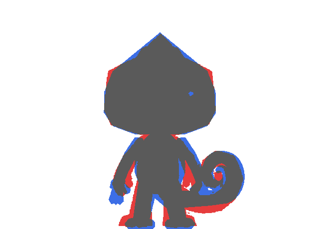
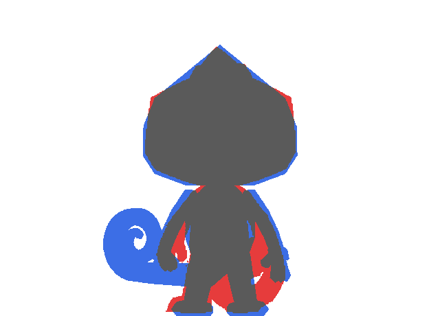

# Diagnóstico técnico 001 — Kumo 2,5D, versão base v1

**Data:** 2026-11-09 · **Arquivo analisado:** `kumo_toon.blend` (= `base/kumo_toon_base_v1.blend`) · **Modelo alterado:** não

Este diagnóstico só inspeciona e compara. Nenhuma geometria foi modificada. As propostas da seção 5 aguardam aprovação, uma a uma.

## 1. Ferramentas criadas (somente leitura)

| Ferramenta | O que faz |
|---|---|
| `tools/kumo_inspect.py` | Abre uma cópia do `.blend` e conta, por objeto, vértices, arestas, faces e o formato das faces (triângulo, quad, n-gon). Também verifica arestas não-manifold, vértices soltos, duplicados, faces de área zero, enrolamento inconsistente e a orientação das normais (pelo volume com sinal). Para a cabeça, lista cada face com área, normal, inclinação, azimute, região e material. |
| `tools/kumo_silhouette.py` | Compara a silhueta ortográfica de cada vista com o recorte da referência, na mesma escala (1 H) e alinhadas pelo chão e pela cabeça. Gera o IoU, o perfil de largura a cada 0,05 H e uma sobreposição colorida. |

Resultados completos: [`inspecao/malha-base-v1.md`](inspecao/malha-base-v1.md) (tabela face a face) e [`inspecao/silhuetas.md`](inspecao/silhuetas.md) (perfis e sobreposições).

Também avaliei os dois repositórios indicados:
- **CLI-Anything:** tem um CLI do Blender para cena, render e modificadores, mas nenhum comando de inspeção de malha. Por isso as duas ferramentas acima seguem o padrão dele (um comando, saída em JSON para agentes e em Markdown para pessoas).
- **Agent-Reach:** busca e leitura de páginas da web e de redes sociais. Fica reservado para quando precisarmos de referências externas, por exemplo outras vistas oficiais do Kumo. Para esta análise, que usa só as referências do repositório, não foi necessário.

## 2. Inventário da malha

**Total:** 65 objetos de malha, com 33.490 vértices, 66.102 arestas e 32.729 faces.

Quase tudo isso vem dos "decalques": malhas finas projetadas sobre a cabeça. Os dois da crista somam 19.544 faces, e as bocas abertas com as línguas somam cerca de 9.200. O corpo propriamente dito tem menos de 2.000 faces.

| Peça | V | E | F | Faces | Normais | Problemas |
|---|---|---|---|---|---|---|
| Cabeça (`Kumo_Head`) | 52 | 105 | 57 | 25 triângulos, 28 quads, 3 pentágonos, 1 octógono | para fora | **2 vértices soltos** em (±0,12, 0,56, 1,43) |
| Crista frontal (decalque) | 10.028 | 19.777 | 9.750 | quads | — (malha aberta) | 552 arestas de borda, **1 aresta não-manifold, 1 aresta solta** |
| Crista da nuca (decalque) | 10.073 | 19.866 | 9.794 | quads | — | 554 arestas de borda, **1 não-manifold, 1 solta** |
| Tronco | 62 | 130 | 70 | 50 quads, 20 triângulos | para fora | — |
| Cauda | 338 | 678 | 342 | 330 quads, 12 triângulos | para fora | — |
| Braço (cada) | 26 | 54 | 30 | 18 quads, 12 triângulos | para fora | — |
| Perna (cada) | 30 | 63 | 35 | 21 quads, 14 triângulos | para fora | — |
| Dedo / polegar (cada) | 20 | 42 | 24 | 12 quads, 12 triângulos | para fora | — |
| Bocas abertas (decalques) | ≈2.200–2.900 cada | | | quads | — | malhas abertas e densas |

Nenhuma peça tem normais invertidas nem enrolamento inconsistente. As peças fechadas têm volume com sinal positivo, ou seja, normais para fora.

## 3. Análise da cabeça (57 faces)

Por região: 10 em cima, 12 embaixo, 12 de frente (frente, frente-superior e frente-inferior), 18 nas laterais e 5 atrás. A tabela face a face está em `inspecao/malha-base-v1.md`.

**Achados:**
- **G1: faces demais na frente.** São 29 faces visíveis da câmera frontal. A referência especifica "12 a 16 faces visíveis". O excesso está concentrado no focinho e no lábio, com 8 triângulos minúsculos (áreas de 0,009 a 0,017).
- **G2: n-gons.** Há um octógono no fundo da cabeça (face 15) e três pentágonos: dois no focinho (faces 7 e 22) e um na nuca (face 33). Num modelo estático isso não causa problema, mas vai sombrear de forma imprevisível quando a cabeça deformar na animação.
- **G3: a crista da nuca não existe como geometria.** Os dois pontos da crista occipital ficaram dentro do volume da cabeça e viraram os vértices soltos. A crista que aparece na render é só o decalque.
- **G4: a crista é decalque, não topologia.** São 19.544 faces projetadas, e as bordas têm "dentes" (serrilhado da grade). Num modelo low poly correto, o losango é delimitado por arestas da própria cabeça.

## 4. Comparação de silhuetas com a referência

| Vista | IoU | Leitura |
|---|---|---|
| Frente | **0,857** | Cabeça dentro de ±0,05 H em todas as alturas. Diferenças localizadas abaixo. |
| 3/4 | **0,693** | A cabeça do modelo sai 0,13–0,17 H mais larga de cada lado, e a cauda não aparece onde a referência a mostra. |
| Perfil | **0,830** | O olho sobressai até 0,10 H na frente. A nuca da referência é mais cheia, e o pé dela se estende mais para trás. |
| Costas | **0,750** | A espiral da cauda está do lado oposto ao da referência. |

   

Nas sobreposições, vermelho é só a referência, azul é só o modelo e cinza é onde os dois coincidem.

**Desvios medidos (Δ = modelo − referência, em H):**

| Código | Região | Medida |
|---|---|---|
| S1 | "Ombro" da cabeça, na frente | Em z 1,50–1,60 o modelo é 0,02–0,04 mais estreito de cada lado. Em z 1,70 é 0,045 mais largo. Na referência, o canto superior da cabeça fica mais alto e mais vivo, e a encosta da crista é mais íngreme. |
| S2 | Nuca, no perfil | Em z 1,50 a referência vai 0,075 mais para trás. |
| S3 | Olho, no perfil | Em z 1,30–1,50 o olho sobressai +0,08 a +0,10 à frente da silhueta. |
| S4 | Mãos, na frente | A mão do modelo desce até z 0,30. Na referência, a mão termina em z ≈ 0,37. |
| S5 | Pé, no perfil | Em z 0,10 o pé da referência vai até −0,245 (calcanhar), e o do modelo até −0,10. |
| S6 | Cauda, na frente | A espiral da referência é maior e mais alta (vermelho acima e à direita da espiral azul). |

**Divergências da própria referência**, que precisam da sua decisão:

- **D1: a vista "3/4" não é um ângulo de 45°.** Uma cabeça com 1,11 H de largura e 1,21 H de profundidade (medidas da frente e do perfil da referência) não pode aparecer com 1,09 H de largura girada a 45°. Uma varredura de câmera na cópia do modelo dá IoU da cabeça de 0,881 a 15°, 0,855 a 25°, 0,830 a 30° e 0,776 a 45°. O desenho 3/4 da referência é inconsistente com a frente e o perfil dela.
- **D2: lado da cauda nas costas.** Na frente, a espiral fica à direita do observador, que é a esquerda do Kumo. Nas costas, a referência a desenha de novo à direita do observador, o que corresponde ao outro lado do corpo. Um modelo 3D só consegue ficar fiel a uma das duas vistas.

## 5. Propostas de alteração localizadas (aguardando aprovação)

Cada item é independente. Depois de cada alteração aprovada, eu entrego uma render ortográfica, rodo de novo as duas ferramentas e registro um relatório antes/depois.

| # | Alteração | Elementos afetados | Efeito esperado |
|---|---|---|---|
| **P1** | Refazer a topologia da cabeça para 12–16 faces frontais. Isso inclui eliminar os 8 triângulos minúsculos do focinho e do lábio e converter os n-gons em quads e triângulos planos. | Só `Kumo_Head` (malha) | Atende G1 e G2. A silhueta da frente se mantém (verificado pela ferramenta). |
| **P2** | Tornar a crista geometria real: cortar o losango frontal e a crista da nuca na malha da cabeça e atribuir o material verde-escuro por face. Os dois decalques são removidos. | `Kumo_Head`, remove `Kumo_Crest_Front` e `Kumo_Crest_Back` | Atende G3 e G4. De 19.544 para cerca de 10 faces, bordas retas e nenhuma aresta não-manifold ou solta. |
| **P3** | Ajustar o "ombro" e a nuca: em z 1,58, afastar os pontos laterais 0,03 e os de trás 0,075; em z ≈ 1,70, recolher 0,045. | Anéis superiores de `Kumo_Head` | Atende S1 e S2. |
| **P4** | Recuar os olhos 0,04 e reduzir a profundidade do globo (0,09 → 0,06). | `Kumo_EyeRig_*` | Atende S3 sem mudar o olho na vista frontal. |
| **P5** | Subir as mãos 0,06 H, encurtando o antebraço. | `Kumo_Arm_*`, mãos | Atende S4. |
| **P6** | Alongar o pé 0,12 H para trás (calcanhar). | `Kumo_Foot_*` | Atende S5. |
| **P7** | Aumentar a espiral da cauda e subi-la (raio e centro), medindo de novo frente e perfil. | `Kumo_Tail` | Atende S6. |
| **P8** | **Decisão D1:** (a) manter a câmera 3/4 a 45°, fiel ao 3D; (b) usar a câmera a ≈25° como a "3/4 oficial", fiel ao desenho; (c) as duas. | Só câmera | — |
| **P9** | **Decisão D2:** (a) manter a cauda fisicamente correta; (b) espelhar a cauda só na render das costas, como exceção documentada. | Cauda / render | — |
| **P10** | Bocas abertas como geometria cortada no rosto, em vez de decalques densos. | Objetos `Kumo_Mouth_*` | Cerca de 9.000 faces a menos, bordas limpas. Baixa prioridade. |

Ordem sugerida: P2 → P1 (os dois mexem na topologia da cabeça) → P3 → P4 → P5 → P6 → P7. P8 e P9 são decisões, e P10 vem por último.
