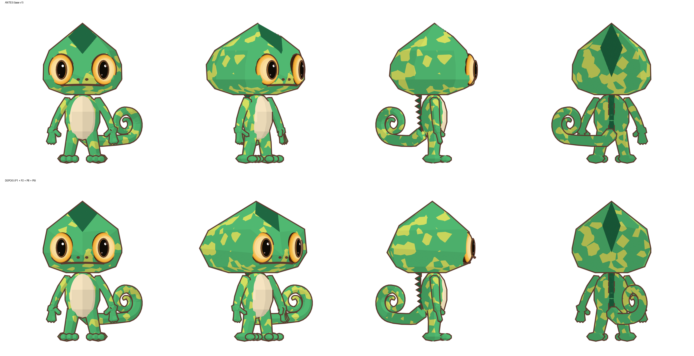

# Relatório de alteração 002 — P1, P2, P8 e P9

**Data:** 2026-11-09 · **Autorização:** do dono, "Pode começar o processo pelo P1 e P2; quanto ao ângulo 3/4, pode seguir a imagem referência, isso também inclui a cauda" · **Base de comparação:** `base/kumo_toon_base_v1.blend` (intocada)

## O que foi alterado

### P1: topologia da cabeça

A cabeça deixou de ser uma envoltória convexa gerada por anéis de pontos. Agora é construída a partir de uma lista explícita de 17 vértices nomeados, cada um com um papel: crista (`T`, `S`, `V`, `Q`, `Bt`), caixa do crânio (`A`, `B`, `D`, `E`, `F`, `G`), queixo (`J`, `K`) e focinho (`N`, `L`). A lista é espelhada no eixo X. Vértices que caem dentro do volume são descartados. Pares de triângulos coplanares (até 1°) viram quads, mas nunca n-gons e nunca atravessando a borda da crista.

| Métrica | Antes (v1) | Depois |
|---|---|---|
| Vértices / arestas / faces | 52 / 105 / 57 | **25 / 63 / 40** |
| Formato das faces | 25 triângulos, 28 quads, 3 pentágonos, 1 octógono | **34 triângulos, 6 quads, 0 n-gons** |
| Faces visíveis de frente | 29 | **15** (meta da referência: 12–16) |
| Vértices soltos | 2 | **0** |
| Malha fechada / normais | sim / para fora | sim / para fora |
| Enrolamento inconsistente, arestas não-manifold | 0 | 0 |

### P2: crista como geometria

Os dois decalques (`Kumo_Crest_Front` e `Kumo_Crest_Back`) foram removidos. A crista agora é feita de **4 faces reais** da cabeça, com o material verde-escuro:

| Face | Região | Vértices |
|---|---|---|
| Losango frontal, metade inferior | frente-superior | `S`, `V`, `S'` |
| Topo da crista | topo | `T`, `S`, `S'` |
| Crista superior traseira | topo | `T`, `Q`, `Q'` |
| Crista da nuca | costas | `Q`, `Q'`, `Bt` |

A crista é uma pirâmide levemente elevada, como na referência. A cena perdeu 19.544 faces, e as bordas do losango agora são retas, sem o serrilhado da grade.

### P8: câmera 3/4

A câmera 3/4 passou de 45° para **40°**. A varredura de ângulos (15° a 45°) mostrou que a silhueta da cabeça casa melhor perto de 15–25°. Só que nesses ângulos os dois olhos aparecem inteiros, enquanto na referência o olho distante fica quase escondido na borda. 40° preserva a leitura dos olhos e do focinho da referência e ainda melhora o IoU.

### P9: cauda segue a referência

A cauda ganhou um pivô na base e uma pose por vista (a cauda é flexível):

| Vista | Rotação em Z | Efeito |
|---|---|---|
| Frente / Perfil | 0° | sem mudança |
| 3/4 | −45° | a espiral fica inteira à direita, como na referência |
| Costas | +80° | a espiral fica à direita do observador, atrás do corpo, como na referência |

Os valores vieram de uma varredura de poses medida pela ferramenta de silhueta.

## Medições: silhueta contra a referência (IoU)

| Vista | Corpo inteiro: antes → depois | Só cabeça: antes → depois |
|---|---|---|
| Frente | 0,857 → 0,857 | 0,954 → 0,953 |
| 3/4 | 0,693 → **0,730** | 0,763 → 0,714 |
| Perfil | 0,830 → 0,804 | 0,917 → 0,912 |
| Costas | 0,750 → **0,851** | 0,935 → **0,943** |

**Leitura honesta dos números:**

- **Melhoras grandes:** as costas (+0,10), por causa da pose da cauda, e a 3/4 do corpo inteiro (+0,04).
- **Cabeça na 3/4: −0,05.** No mesmo ângulo de 45°, a cabeça nova pontua 0,724 contra 0,763 da antiga. A cabeça nova tem cantos de caixa mais vivos, que alargam a silhueta girada. Parte da queda também vem da troca de 45° para 40°.
- **Perfil do corpo inteiro: −0,026.** A ferramenta alinha as silhuetas pelo centro da cabeça, que andou alguns centésimos para trás. Por isso a queda do corpo inteiro é maior que a da cabeça (−0,005).
- **No perfil**, a nuca agora forma um canto vivo no meio, em z ≈ 1,30 (vértice `E`). Na referência a nuca é mais arredondada.

## Pendências e próximos passos sugeridos

1. **Divergência nova, para sua avaliação:** na vista 3/4, a cabeça ficou mais larga que a da referência (IoU da cabeça 0,714). Isso pode ser tratado junto com a P3 (ombro e nuca), sem mexer de novo na topologia aprovada.
2. A P3 também resolve o canto da nuca no perfil.
3. P4 a P7 e P10 continuam aguardando aprovação.

Detalhe completo: [`inspecao/malha-p1p2.md`](inspecao/malha-p1p2.md) (tabela face a face) e [`inspecao/p1p2/silhuetas.md`](inspecao/p1p2/silhuetas.md) (perfis e sobreposições).
