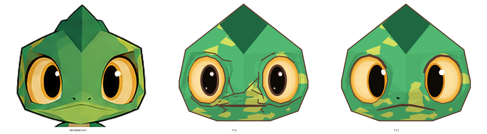
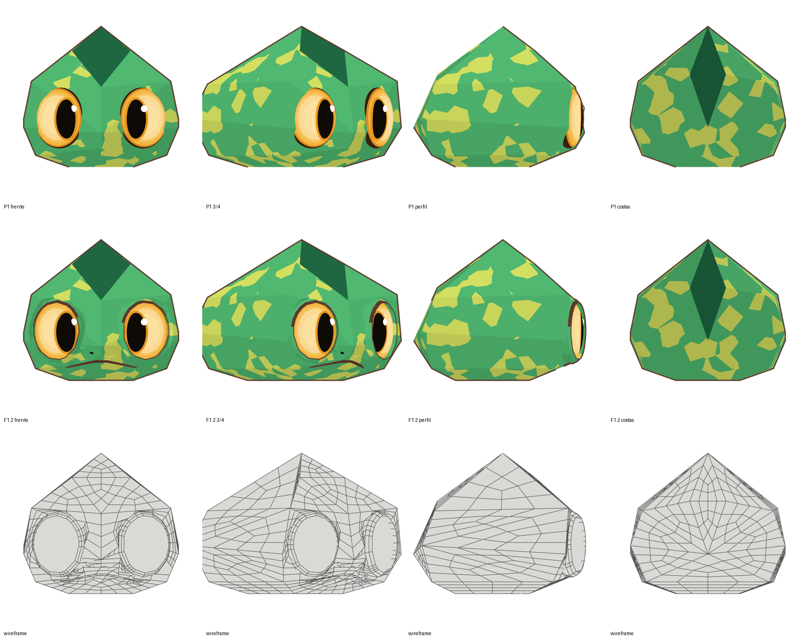
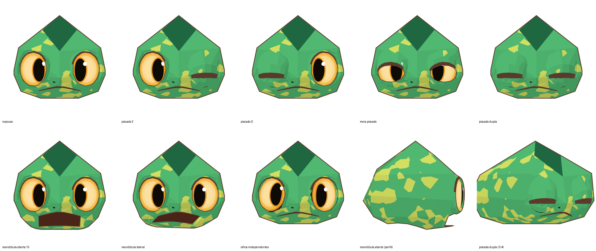

# Relatório F1.2 — segunda versão visual da cabeça deformável

**Data:** 2026-11-09 · **Pedido do dono:** "reunir tudo o que foi aprendido para desenvolver a segunda versão visual do Kumo, com atenção às duas imagens", que são a `kumo-referencia-01.png` e a `kumo-referencia-03-analise-geometrica.png`, idênticas byte a byte às já guardadas no repositório · **Escopo:** continua sendo a F1 (só a cabeça). A F2 não foi iniciada.

**Versionamento:**
- A F1.0 está preservada: o script foi congelado em `src/kumo_v2_head_f1_0.py`, e o `.blend` e os renders continuam em `v2-deformavel/`.
- A F1.2 está em `v2-deformavel/f1.2/`, gerada por `src/kumo_v2_head.py`.
- A `base/` e a versão atual não foram tocadas.

## 1. O que mudou e por quê (medido na referência 01, vista frontal, em H)

| Elemento | F1.0 | Referência 01 | F1.2 |
|---|---|---|---|
| Linha da boca | Reta em z 1,085, x ±0,21 | **"^" suave**: centro em z 1,097, cantos em ±0,255 a z 1,046 | Igual à referência (`mouth_z(x)`) |
| Pupila | Semieixos 0,068 × 0,122, deslocada 0,034 para o nariz | **0,067 × 0,139**, deslocada **0,073** para o nariz, 0,01 abaixo | Igual à referência, ainda como malha própria (D5) |
| Aro da pupila | 0,078 × 0,132 | Cerca de 0,016 de largura | 0,083 × 0,155 |
| Brilhos | 2 | **1**, raio 0,025, em +0,054 / +0,074 do centro da pupila (mesmo lado nos dois olhos) | 1, como na referência |
| Pálpebra superior | Sem faixa escura | **Faixa escura** no alto do olho | Faces escuras no anel da margem (sen θ > 0,3). É geometria, então desce junto na piscada. |
| Narinas | Losangos quase invisíveis | **Fendas inclinadas** em (±0,065, 1,148), a ±35° | Fendas 0,048 × 0,022, inclinadas, cor da pupila |
| Linhas internas | Freestyle desenhava vincos e quinas soltos | Só o contorno externo, a borda do olho e a boca | Contorno externo e **linhas marcadas** (borda da pálpebra, lábio). As linhas soltas sumiram. |
| Dobra da pálpebra | 1 anel, projetado para fora (vinco visível) | Sem vinco | **2 anéis sobre os planos aprovados**: sem vinco em repouso, e a piscada rola em dois passos |
| Pesos da mandíbula | Corte duro, lábio inferior quase sem peso | — | Lábio inferior com peso total, com transição suave nas bochechas |

## 2. Fidelidade à P1 em repouso (IoU da silhueta, mesmas câmeras)

| Frente | 3/4 | Perfil | Costas |
|---|---|---|---|
| 0,997 | 0,996 | 0,983 | 0,997 |

A pequena perda contra a F1.0 (que ficava entre 0,990 e 1,000) vem da boca mais larga e das narinas, que chegam ao contorno na 3/4 e no perfil.

## 3. Topologia

| Métrica | F1.0 | F1.2 |
|---|---|---|
| Faces | 745 | 799 |
| Quads | 725 (97,3 %) | **775 (97,0 %)** |
| Triângulos | 20, no fundo da boca | 24, no fundo da boca, invisíveis |
| N-gons, não-manifold, faces de área zero | 0 | **0** |
| Anéis por olho | 5 | **6** (2 de dobra, 2 de pálpebra, margem, forro) |
| Bordas abertas | 44 (forro das órbitas, atrás do globo) | 44, igual |

## 4. Deformação

| Pose | Invertidas | Colapsadas | Esticadas (> 3×) | Comparado com a F1.0 |
|---|---|---|---|---|
| Piscada E / D | 4 / 5 | 3 / 4 | 13 / 12 | Melhor (era 6/6, 4/5, 14/9) |
| Piscada dupla | 9 | 7 | 25 | Melhor (era 12, 9, 23) |
| Meia piscada | 2 | 0 | 8 | Melhor (era 4, 0, 7) |
| Mandíbula aberta | 0 | 0 | 11 (a 15°) | Na F1.0, a 22°, os lábios não se separavam e 31 faces esticavam. Agora a boca **abre de fato**. |
| Mandíbula lateral | 0 | 0 | 9 | Equivalente |
| Olhos independentes | 0 | 0 | 0 | Igual |

## 5. O que ainda diverge (para sua decisão; nada foi alterado sem aprovação)

1. **Crista:** na referência, o losango frontal é mais estreito e mais alto. A cabeça também tem um "degrau", o ombro do crânio em z ≈ 1,75 com a crista erguida acima dele. É a geometria aprovada na P1/P2, por isso não mudei. Fica como proposta para a **P3**.
2. **Boca aberta:** o interior aparece como um retângulo escuro, porque a cavidade é rasa e reta. Na F4 (expressões), a boca precisa de formas definidas por shape keys, por exemplo cantos arredondados.
3. **Perfil com a mandíbula aberta:** o queixo avança um pouco para a frente.
4. **Tons das facetas:** a referência tem cada plano num tom diferente de verde, e o focinho e as bochechas mais claros. Isso é material e iluminação, para a **F6**.
5. **Narinas:** ainda ficam menores que as da referência quando vistas de longe.

## 6. Checklist Match / Close / Miss (repouso contra a referência 01)

| Categoria | F1.0 | F1.2 |
|---|---|---|
| Silhueta da cabeça | Match | Match |
| Facetas e sombreamento chapado | Match | Match |
| Crista | Close | Close (P3 pendente) |
| Olhos: tamanho e posição | Match | Match |
| Pupila e brilho | Close | **Match** |
| Faixa escura da pálpebra superior | Miss | **Match** |
| Boca: forma e largura | Miss | **Match** |
| Narinas | Close | Close |
| Linhas internas | Miss | **Match** |
| Deformação: piscada / mandíbula / olhos | Match / Close / Match | Match / **Match** / Match |
