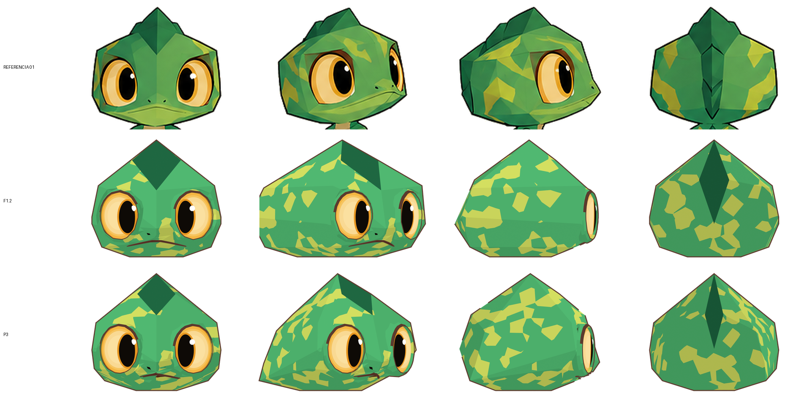
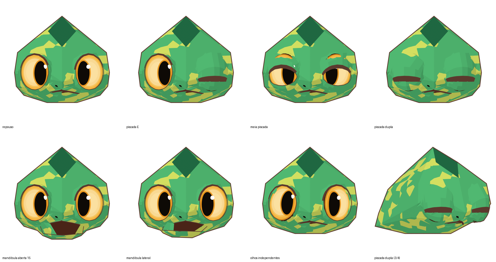

# Relatório P3 — forma do crânio ajustada às silhuetas da referência

**Data:** 2026-11-10 · **Autorização:** dono, "Sim fique a vontade" (P3 como próxima etapa) · **Estado:** **proposta, aguardando aprovação**. A F1.2 aprovada continua intacta em `f1.2/`.

## Método

1. **Tentativa 1, descartada:** encaixar os 15 vértices nomeados da cabeça direto na superfície do modelo Rodin (`src/fit_head_to_rodin.py`). O crânio do Rodin é mais arredondado, então o encaixe puxava os cantos para dentro (até −0,20 H) e apagava as facetas. Resultado guardado só como registro em `rodin_radial_fit_rejeitado.json`.
2. **Tentativa 2, adotada:** otimizar os mesmos 15 vértices contra as **silhuetas da referência 01** nas 4 vistas, ao mesmo tempo (`src/fit_head_silhouettes.py`). A câmera 3/4 continua em 40° (P8).
   - **Restrições:** a ponta da crista (T) e a placa do queixo (J, K) mantêm a altura; os vértices do eixo central ficam em x = 0; cada coordenada move no máximo 0,12 H; uma penalidade mantém os movimentos mínimos.
   - O resto do pipeline é o mesmo da F1.2: subdivisão plana, anéis dos olhos e da boca, rig e testes. O script aceita `--head-verts p3/head_verts_p3.json`.

## Resultado: semelhança da silhueta da cabeça (IoU)

| Vista | P1/F1.2 | **P3** |
|---|---|---|
| Frente | 0,959 | 0,958 |
| 3/4 | 0,724 | **0,873** |
| Perfil | 0,909 | **0,968** |
| Costas | 0,954 | **0,964** |

## Vértices alterados (H)

| | P1 | P3 | Efeito |
|---|---|---|---|
| S (canto do losango da crista) | (0,21, −0,21, 1,79) | (0,165, −0,23, 1,79) | crista mais estreita |
| V (ponta do losango) | (0, −0,50, 1,53) | (0, −0,45, 1,605) | losango mais curto |
| Q, Bt (crista da nuca) | … | mais estreita e mais alta | |
| A (canto superior da testa) | (0,50, −0,45, 1,57) | (0,52, −0,335, 1,54) | testa mais recuada |
| B, E (crânio traseiro) | … | recuados e mais baixos | nuca menos "caixa" no perfil e na 3/4 |
| D, F (bochecha) | … | mais para trás e mais alto | |
| J, K (queixo) | x 0,23 / 0,22 | x 0,12 / 0,175 | queixo mais estreito |

## Topologia e deformação

- **Malha:** 891 faces, 869 quads (97,5%) e 22 triângulos, todos dentro da boca. Nenhuma face de mais de 4 lados.
- **Borda interna das órbitas:** 60 arestas abertas, que é a abertura intencional atrás do globo ocular.
- **Correção nova:** o recorte das órbitas passou a evitar bordas em "oito", que apareceram com a nova forma.

| Pose | Invertidas | Colapsadas | Esticadas | F1.2 |
|---|---|---|---|---|
| Piscada dupla | 14 | 9 | 33 | 9 / 7 / 25 |
| Meia piscada | 2 | 0 | 7 | 2 / 0 / 8 |
| Mandíbula aberta | 0 | 0 | 11 | igual |
| Mandíbula lateral | 1 | 0 | 7 | 0 / 0 / 9 |
| Olhos independentes | 0 | 0 | 0 | igual |

## Pontos fracos (avaliação honesta)

1. **A boca ficou menor:** o queixo mais estreito puxou os planos do focinho para dentro. Na referência a boca é mais larga.
2. **Losango da crista frontal menor:** o otimizador reduziu o losango, mas na referência ele é grande e bem visível. A nota de silhueta não "vê" o losango, porque ele é cor e não contorno.
3. **Piscada um pouco pior** (14 faces invertidas contra 9): as órbitas mudaram de forma.
4. A semelhança só mede o contorno. Detalhes internos e a "personalidade" do rosto precisam de olho humano.

## Decisões pedidas

- **(a)** Aprovar a P3 como está.
- **(b)** Aprovar a nova forma do crânio, mas **restaurar a largura do queixo/focinho e o tamanho do losango da P1** (minha recomendação).
- **(c)** Manter a F1.2.
