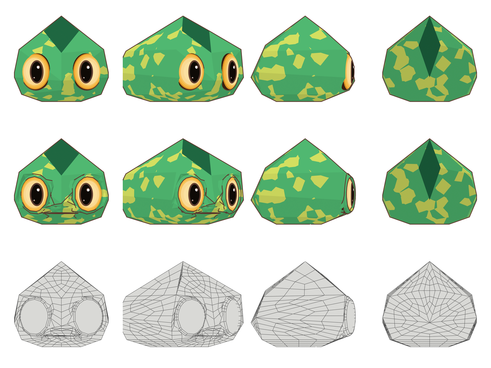
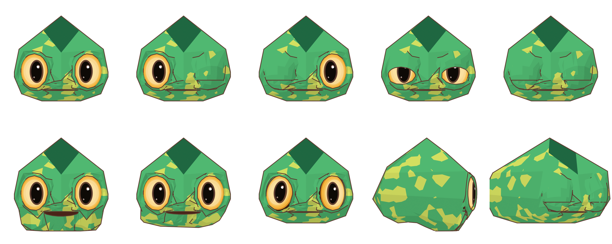

# Relatório F1 — cabeça deformável (Kumo v2)

**Data:** 2026-11-09 · **Autorização:** dono, "aprovo a arquitetura V2 e autorizo o início da F1 — cabeça deformável" · **Decisões aplicadas:** D3 (A-pose, ainda sem efeito na F1), D4 (sistema híbrido), D5 (pupila como malha própria)

**Local:** `kumo-3d-toon/v2-deformavel/`. A `base/` e a versão atual (`kumo_toon.blend`, `src/kumo_toon.py`) **não foram tocadas**.

## 1. Arquivos

| Arquivo | Conteúdo |
|---|---|
| `src/kumo_common.py` | Cópia versionada da paleta, dos materiais toon e dos 25 vértices aprovados da cabeça P1/P2 |
| `src/kumo_v2_head.py` | Gera a cabeça deformável, o rig de teste, as renders e as métricas |
| `kumo_v2_head.blend` | Cena: `Kumo_v2_Head` (malha), globos, pupilas, brilhos, `Kumo_v2_Rig` e a cópia oculta `P1_Reference_Head` |
| `renders/` | Repouso (4 vistas), wireframe (4 vistas), P1 nas mesmas câmeras e 7 poses de teste |
| `relatorios/malha-f1.md` / `.json` | Inspeção completa (`tools/kumo_inspect.py`) |
| `relatorios/iou-vs-p1.json`, `deformation-metrics.json` | Medidas |

## 2. Construção

1. **Mesmos 25 vértices da P1**, a mesma envoltória convexa e as mesmas faces de crista.
2. **Subdivisão simples, sem suavização (×2):** cada triângulo vira 3 quads e cada quad vira 4. Os vértices novos ficam **sobre os planos originais**, então a silhueta e o sombreamento chapado não mudam. As bordas de faceta são marcadas como arestas vivas.
3. **Olhos:** as faces sobre cada olho viram 5 anéis concêntricos de quads: borda da órbita → dobra → pálpebra 1 → pálpebra 2 → margem da pálpebra → forro da órbita. **As pálpebras fazem parte da malha da cabeça.**
4. **Boca:** 3 anéis (lábio externo → lábio → margem) mais o saco bucal com o material escuro. As margens superior e inferior se encontram na linha da boca (z = 1,085 H). A largura (±0,21 H) foi medida na referência 01.
5. **Narinas:** pequenas reentrâncias na própria malha.
6. **Rig de teste (D4, híbrido):** ossos `Head`, `Jaw`, `Eye.L` e `Eye.R`, e shape keys `Blink_L` e `Blink_R`. Os globos oculares são malhas rígidas presas aos ossos dos olhos. **Pupila, aro e brilhos (D5)** são malhas próprias presas a cada globo. A pupila é uma calota que segue a curvatura do globo, para não atravessar a pálpebra fechada.

## 3. Topologia

| Métrica | P1 (aprovada) | F1 |
|---|---|---|
| Vértices / arestas / faces | 25 / 63 / 40 | 757 / 1.502 / 745 |
| Quads | 6 | **725 (97,3 %)** |
| Triângulos | 34 | 20, todos no fundo do saco bucal, invisíveis |
| N-gons | 0 | **0** |
| Arestas não-manifold / vértices soltos / faces de área zero | 0 | **0** |
| Faces de crista | 4 | 48 (as mesmas 4 regiões, subdivididas) |
| Arestas de borda | 0 (fechada) | 44: a borda interna do forro de cada órbita, escondida atrás do globo. É intencional, a abertura onde o olho encaixa. |

## 4. Fidelidade em repouso (IoU da silhueta contra a P1, mesmas câmeras)

| Frente | 3/4 | Perfil | Costas |
|---|---|---|---|
| **1,000** | **1,000** | **0,990** | **1,000** |

A pequena diferença no perfil é a pálpebra, que agora envolve o globo e se projeta cerca de 0,01 H à frente.

Linha 1: P1. Linha 2: F1 em repouso. Linha 3: wireframe da F1.

## 5. Testes de deformação

Linha 1: repouso, piscada esquerda, piscada direita, meia piscada, piscada dupla. Linha 2: mandíbula aberta (22°), mandíbula lateral, olhos independentes, mandíbula aberta de perfil, piscada dupla na 3/4.

As métricas comparam cada face com a pose de repouso: faces invertidas, faces colapsadas (área abaixo de 15%) e faces esticadas (área acima de 3×).

| Pose | Invertidas | Colapsadas | Esticadas | Leitura visual |
|---|---|---|---|---|
| Piscada E / D | 6 / 6 | 4 / 5 | 14 / 9 | Fecha totalmente, sem frestas. As faces comprimidas ficam na dobra da pálpebra, escondidas no vinco. |
| Piscada dupla | 12 | 9 | 23 | Idem, nos dois olhos. |
| Meia piscada | 4 | 0 | 7 | Pálpebra superior a meio caminho, limpa. |
| Mandíbula aberta 22° | 0 | 0 | 31 | Boca abre com o interior escuro. As faces esticadas são as das bochechas, que fazem a transição. |
| Mandíbula lateral | 0 | 0 | 4 | Limpa. |
| Olhos independentes | 0 | 0 | 0 | Cada globo gira sozinho, e a pupila acompanha. |

## 6. Problemas conhecidos (para a sua avaliação)

1. **Linhas de contorno extras em volta dos olhos e do focinho.** O Freestyle, usado só nestas renders de revisão, desenha o vinco da dobra da pálpebra e as quinas do focinho. Na referência não existem. A F5 (casca invertida) é a fase que controla isso, com o mapa de pesos do contorno.
2. **Compressão no vinco da pálpebra fechada:** 4 a 12 faces invertidas por piscada, escondidas dentro da dobra. Para uma piscada perfeitamente limpa, a próxima iteração pode acrescentar um anel extra na dobra, ou um osso de pálpebra para animação.
3. **Mandíbula com 22°:** a bochecha estica (31 faces acima de 3×). Para aberturas maiores, convém mais um anel na linha da mandíbula.
4. **Expressões (boca sorrindo, sobrancelhas)** ficam para a F4, como shape keys sobre esta malha.

## 7. Checklist Match / Close / Miss (repouso contra P1 e referência)

| Categoria | Avaliação |
|---|---|
| Silhueta da cabeça | **Match** (IoU de 0,99 a 1,00) |
| Facetas / sombreamento chapado | **Match** |
| Crista (losango, topo, nuca) | **Match** |
| Olhos: tamanho e posição | **Match** |
| Pupila vertical e brilhos | **Match** |
| Boca: linha e largura | **Close** (vinco mais marcado que na referência) |
| Narinas | **Close** |
| Linhas internas | **Miss** (contornos extras do Freestyle, ver item 6.1) |
| Deformação: piscada / mandíbula / olhos | **Match / Close / Match** |
